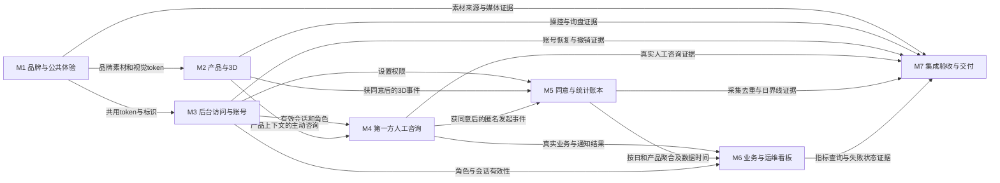

# 系统架构与模块划分

本规格描述目标实现，源码基线仍为971b5b46。现有代码与恢复草稿作为输入，不把未合并分支或本规格中的规划目录当成已实现能力。系统沿用单个Next.js应用、PostgreSQL及现有内容/通知集成。

## 模块职责与依赖

| 模块 | 职责 | 依赖 |
|---|---|---|
| M1 | 品牌与公共体验：负责现用 PackJoyU 字标、己方可证公司内容、JPG/GIF 发布副本、首页媒体和前台公共页面，并作为全站前后台视觉 token 的唯一归属；不承担后台权限或后台外壳。 | — |
| M2 | 产品与 3D：负责产品列表、卡片和详情中的产品表达、直接模型操控、输入冲突处理、触屏与键盘查看、图片回退及带产品上下文的询盘入口。 | M1，M4，M5 |
| M3 | 后台访问与账号：负责统一后台登录页和后台公共外壳、个人设置、设备会话、验证器绑定与登录方式切换、会话撤销及独立受限恢复；消费 M1 的视觉 token。 | M1 |
| M4 | 第一方人工咨询：负责访客必要会话、人工消息与离线留言、ADMIN/SALES 收件箱和回复、未读、失败草稿与幂等重试，并保存真实收件和通知结果。 | M1，M3，M5 |
| M5 | 同意与统计账本：负责分析同意、匿名浏览器与事件标识、采集准入和去重、站点统计时区设置、日与产品聚合、原始与聚合保留及可重算边界，产出真实访问和 3D 统计。 | M3 |
| M6 | 业务与运维看板：负责按角色查询并解释统计结果，读取询盘、聊天、接口错误、邮件、存储和备份的真实来源，区分数据时间、零值、无数据、未接入、失败和旧值。 | M1，M3，M4，M5 |
| M7 | 集成验收与交付：负责访客跨模块完整路径、后台权限与恢复路径、统计和可靠性完整链路的真实集成验收及交付证据收口；核对本轮复用的恢复来源，不重做 S1 已完成的取回和来源审计，也不自动合并恢复草稿。 | M1，M2，M3，M4，M5，M6 |

依赖列指向被调用职责。数据回传、客户端发事件与验收证据流不是反向代码依赖；M5不导入M6，M4成功保存和回复不等待M6查询。M1拥有唯一视觉token；M3拥有后台外壳并消费token。恢复取回和首次来源审计已经完成，只有安全复用及最终串联验收仍在本次任务范围内。

## 数据流

必要人工咨询不依赖分析同意。图中进入M5的产品与聊天分析事件均经过同意门控且不含咨询正文、邮箱或原始IP。M6只消费各源的可授权结果，不反向参与核心业务事务。

## 全项目共用约定

以下四项与presentation.json的architecture.shared逐字同源，适用于所有新增任务。已有未触达模块保持原契约，扩展在真实调用边界渐进完成。

### errors（错误体系）

src/lib/contracts/errors.ts是新增账号设置/恢复、聊天、统计、看板AppErrorCode与FieldError的唯一来源，第10节同名表逐项镜像；src/lib/server/http/errors.ts唯一映射HTTP，前端src/lib/client/api-errors.ts映射多语言文案；新增错误体为{error,requestId,fieldErrors?}、成功直接用有名DTO，现有Auth.js、{error}、邮件状态体、/api/rum空体及其他旧端点不改信封；禁止把未知码显示原始异常或用新码覆盖Auth.js协议。

### env（环境变量）

新增变量及本轮触及的安全参数接入src/lib/server/config.ts与prod-env-check.ts集中Zod验证，服务端变量沿AUTH_/ADMIN_/CHAT_/ANALYTICS_/CRON_命名，公开变量仅NEXT_PUBLIC_且不得含密钥或内网地址；业务代码禁止直接读取新增process.env，未触及旧适配器不借机全库重构；秘密只在服务器受权限保护的环境文件或CI secret，示例只写变量名/假值，禁止提交真实值。

### types（共享类型）

新增请求/响应Zod schema置src/lib/contracts/{account,recovery,chat,analytics,ops}.ts，z.infer手工导出DTO并从src/lib/contracts/index.ts统一出口，server解析和client只读同源schema；第10节字段表与DTO同名，Auth.js扩展仅src/types/next-auth.d.ts，Prisma实体不直接传客户端；既有admin/types与邮件契约保持原入口，禁止在组件/route复制新增接口类型或用any绕过契约。

### naming（命名与格式）

文件kebab-case.ts、React组件PascalCase.tsx、函数/JSON字段camelCase、类型PascalCase、常量UPPER_SNAKE_CASE、Prisma模型PascalCase，既有枚举不改名；新HTTP路径小写kebab-case，时间ISO8601 UTC、日标签YYYY-MM-DD且携timezone/revision；沿eslint.config.mjs、tsconfig.json及实际可执行lint/type/build约束，禁止新加格式化库、批量改旧文件或用本机时区算今日。

## 接线注册表

表列目标实现的注册位置，部分是待创建文件。只登记实际适用的八类，不增加线上判断层或本机壳。Next动态目录含方括号，工具写范围采用无方括号父目录，正文保留精确路由；这会保守串行化少量页面接线任务。

| 类别 | 仓库相对路径 | 注册责任 | 实际调用入口 |
|---|---|---|---|
| backendRoutes | `src/auth.ts`、`src/app/api/auth/`、`src/app/api/auth-admin/`、`src/app/api/admin/account/`、`src/app/api/admin/users/`、`src/app/api/chat/`、`src/app/api/admin/chat/`、`src/app/api/analytics/`、`src/app/api/admin/settings/analytics/route.ts`、`src/app/api/admin/stats/route.ts`、`src/app/api/admin/cron/operations/route.ts`、`src/app/api/admin/cron/mail-queue/route.ts`、`src/app/api/internal/ops-report/route.ts` | Auth.js及App Router处理器、API目录 | 页面/客户端按10节发请求；守卫在实际handler再次执行 |
| container | `src/lib/server/composition.ts`、`src/lib/server/db.ts`、`src/auth.ts` | 显式服务依赖及唯一数据库客户端 | route和Auth.js回调导入组合后的服务 |
| sharedTypes | `src/lib/contracts/index.ts`、`src/types/next-auth.d.ts` | 新增schema/DTO出口与Auth.js类型扩展 | 服务端解析与客户端消费同一契约 |
| eventKinds | `src/lib/contracts/analytics.ts`、`src/lib/contracts/chat.ts` | 分析/聊天事件与状态枚举 | 客户端生产者、服务端校验及归因使用同一kind |
| migrations | `prisma/schema.prisma`、`deploy/deploy.sh` | schema-first增量与现有部署检查 | deploy.sh备份→diff→plan-check→db push→零漂移 |
| jobs | `src/lib/server/jobs/registry.ts`、`deploy/cron.nbshiyan` | 固定作业注册与真实cron模板 | Bearer调度入口→job registry→服务；无任意代码任务 |
| buildPipeline | `package.json`、`next.config.ts`、`eslint.config.mjs`、`tsconfig.json`、`prod-env-check.ts`、`src/instrumentation.ts`、`src/styles/tokens.css`、`src/styles/motion-tokens.css` | 现有Next/类型/lint/启动检查与集中CSS变量 | 现有build入口、全局CSS和运行时启动检查 |
| frontendRoutes | `src/lib/navigation/routes.ts`、`src/i18n/routing.ts`、`src/i18n/navigation.ts`、`src/components/layout/SiteHeader.tsx`、`src/components/layout/SiteFooter.tsx`、`src/components/admin/AdminShell.tsx`、`src/app/`、`src/app/admin-login/`、`src/app/admin-enroll/`、`src/app/admin-recovery/`、`src/app/admin/account/`、`src/app/admin/chat/`、`src/app/admin/stats/`、`src/app/admin/settings/`、`src/app/admin/users/` | 路径工厂、导航、页面与后台外壳 | 07节可见控件→真实页面/客户端调用 |

M5首次交付JobState/固定作业基础与分析注册；M4/M6随各自功能追加业务作业，M7只验收最终链路。共享HTTP计数生产者在认证/HTTP基础中，M6只读；不能让账号、聊天或统计反向依赖看板。

## 基础能力与界面落地顺序

模块表表示服务及基础能力方向，不把整个模块锁成一个实施批次。任务DAG按实际提供方安排：M3基础认证先支持M6，而M3自定义登录UI等待真实stats目标可见；M3服务不得导入或反调M6服务。界面可见性验收的先后不改变模块服务方向。
