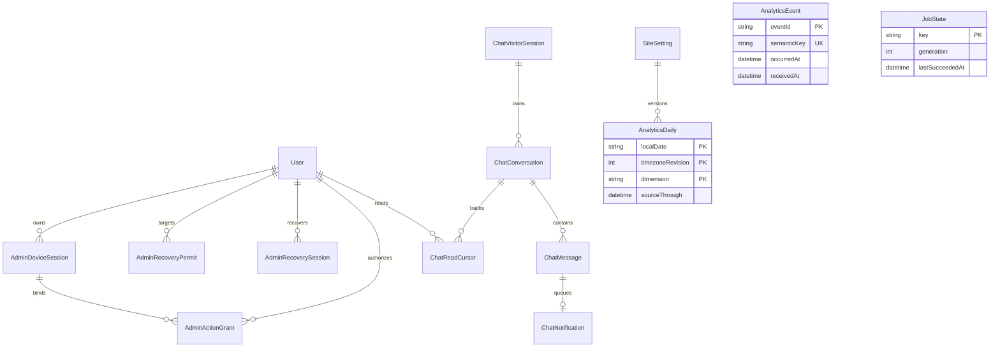
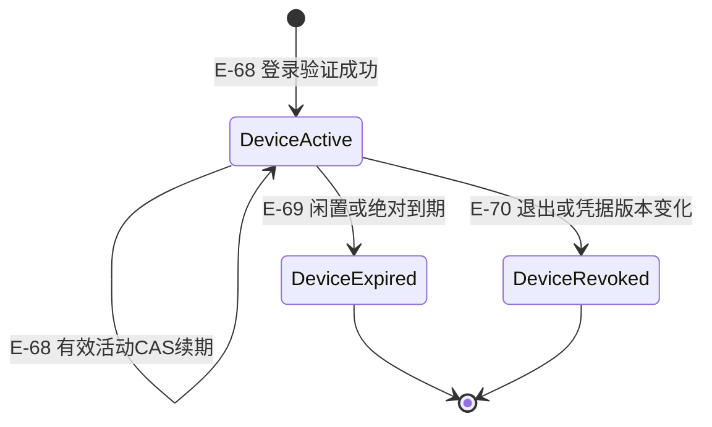
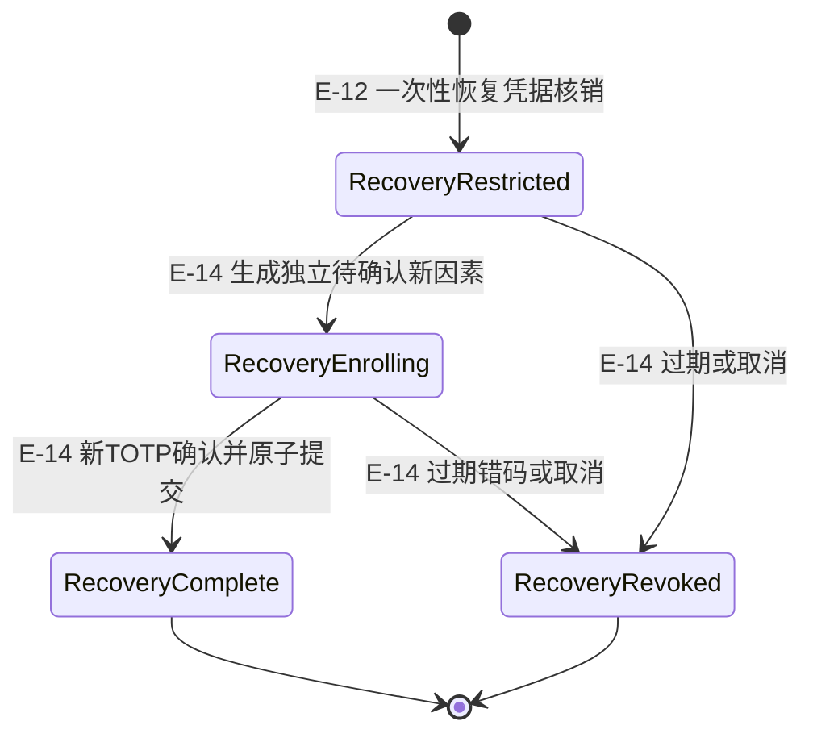
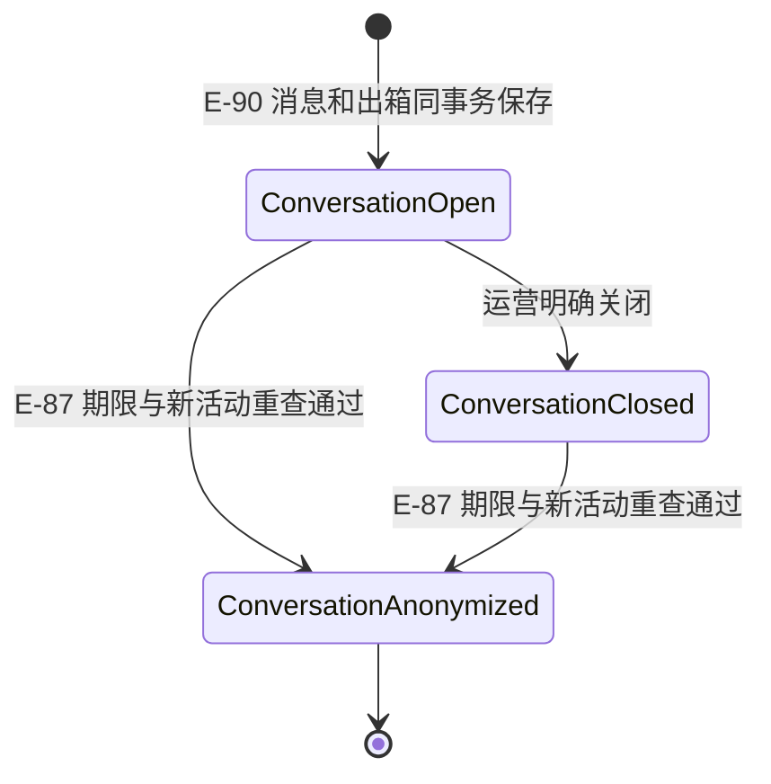
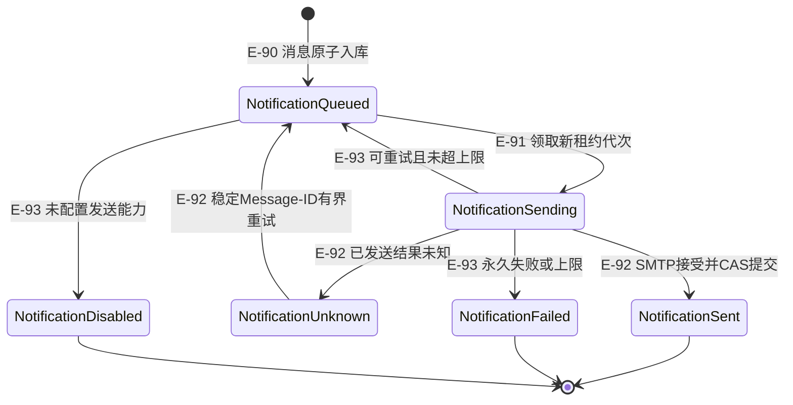

# 数据模型

## 已有实体的最小增量

| 实体 | 增量字段/不变项 | 约束与并发规则 |
|---|---|---|
| User | 新增 `passwordlessEnabled Boolean @default(false)`；保留 passwordHash、totpSecret、totpEnabled、totpLastStep、recoveryCodes、sessionVersion、disabled、lockedUntil | 开启仅本人新鲜验证+当前已确认绑定；关闭不删除 TOTP。密码、TOTP 重置、账号禁用、退出全部设备都递增 sv。角色每次从当前 User 读取，不信JWT旧role。没有sid的旧JWT在功能上线后统一重新登录，不补造设备行。 |
| SiteSetting | 新 key `analytics.settings`，value `{version,timezone,timezoneRevision,changedAt,updatedBy}`；初值 UTC/revision1 | 复用既有版本CAS与事务行锁；timezone必须是运行时Intl支持的IANA名称；变更时先保存新revision与重算待办，旧聚合保留原revision，不改已有about/org键。 |
| AuditLog | 不新增PII字段；新增白名单 action，如 `account.device_revoke`、`account.mode_change`、`recovery.issued/started/completed`、`analytics.timezone_change` | 只记actor/target、source、结果码、发生时间及所需原因；禁止密码、验证码、令牌、恢复码、TOTP密钥、cookie、聊天正文或邮箱进入meta。审计与敏感数据库变更同事务。 |
| MailMessage / Inquiry / Contact / Model3D | 默认不改表，继续原邮件状态、询盘角色范围和业务保留期 | 使用专属ChatNotification，聊天不伪造Inquiry/Contact行。当前询盘默认730天与本轮聊天期限分离。 |

## 新增实体

| 实体与归属 | 字段（除注明外必填） | 主键/唯一/索引/生命周期 |
|---|---|---|
| AdminDeviceSession（M3） | `id` 随机至少192bit，`userId` FK，`sessionVersion Int`，`remembered Boolean`，`createdAt`，`lastActivityAt`，`absoluteExpiresAt DateTime?`，`hardExpiresAt DateTime?`（可空；普通会话为创建后12小时，记住设备为创建后30天），`revokedAt DateTime?`，`revokedReason String?`，`deviceLabel String?`（粗粒度浏览器/系统，不存UA原文） | PK id；索引userId/revokedAt、absoluteExpiresAt。sid只在加密JWT内；普通会话2h活动滑动，另加创建后12h绝对截止，记住会话7d活动闲置/创建后30d绝对。hardExpiresAt 记下该绝对截止，续期不改；对外 absoluteExpiresAt 只属于记住设备，普通会话保持空。Auth.js适配层同时裁定JWT与Set-Cookie期限，都不得超过该绝对截止。到期等号拒绝，且发生在写入 lastActivityAt 之前。清理撤销/过期行前保留安全审计；不以删行代替撤销成功。 |
| AdminActionGrant（M3） | `id`，`tokenHash` SHA256，`userId`，`deviceSessionId`，`sessionVersion`，`purpose` 枚举LOGIN_MODE/PASSWORD/TOTP_RESET/RECOVERY_AUTHORIZE/DEVICE_REVOKE/LOGOUT_ALL，`targetId String?`（按purpose为目标user/device或本人），`createdAt`，`expiresAt`，`usedAt DateTime?` | tokenHash唯一；索引userId/purpose/expiresAt。随机256bit明文只在签发响应内一次返回，前端只放内存；5min、单用途、目标与设备绑定。核销条件包含未用、未过期、当前sv/sid/target，必须与最终动作同事务；获取必须当前密码+未使用TOTP。 |
| AdminRecoveryPermit（M3） | `id`，`tokenHash`，`targetUserId`，`source` ADMIN/SERVER_OWNER，`issuedById String?`，`reason`，`pendingPasswordHash String?`（仅SERVER_OWNER本地TTY预授权），`sessionVersion`，`createdAt`，`expiresAt`，`consumedAt DateTime?` | tokenHash唯一，15min；ADMIN须新鲜验证且目标不能是自己，服务器所有者通过受OS权限保护的本地CLI签发同类凭据，写source与原因；不提供匿名邮件签发。核销CAS与受限session创建同事务；重复请求不能取得第二个session。 |
| AdminRecoverySession（M3） | `id`，`tokenHash`，`userId`，`sessionVersion`，`source` RECOVERY_CODE/ADMIN/SERVER_OWNER/SELF_REAUTH，`createdAt`，`expiresAt`，`pendingSecretEncrypted String?`，`pendingUntil DateTime?`，`pendingPasswordHash String?`（仅本地TTY预授权写入，HTTP不可写），`passwordResetSource String?`，`failedAttempts Int @default(0)`，`completedAt DateTime?`，`revokedAt DateTime?` | tokenHash唯一，10min受限；cookie与Auth.js会话完全不同，只有recovery/enroll和confirm接收；同一账号只保留当前sv的恢复session，5次错码作废；本地permit中的预授权密码hash仅在该事务转入session。secret沿现有AES-GCM密钥封装，不返回到日志/查询；没有后台角色和任意callbackUrl。 |
| ChatVisitorSession（M4） | `id`，`tokenHash`，`createdAt`，`lastActivityAt`，`absoluteExpiresAt`，`revokedAt DateTime?` | cookie为随机256bit原值、DB只存hash；7d闲置/首次30d绝对；仅主动联系时创建。cookie缺失/被清除不通过邮箱找回旧对话，重新开始。仅主动打开联系或成功发消息可touch闲置期限，轮询/读标记不touch；服务端先验未过期再更新，cookie回写不可越30d。索引expiry；token无URL/HTML/localStorage副本。 |
| ChatConversation（M4） | `id` 随机ID，`visitorSessionId` FK，`clientConversationId UUID`，`createPayloadHash`，`locale en/ru`，`productSlug String?`，`sourcePath String?`，`email String?`，`status OPEN/CLOSED`，`version Int`，`lastSeq Int @default(0)`，`visitorReadSeq Int @default(0)`，`createdAt`，`updatedAt`，`lastActivityAt`，`retainUntil`，`anonymizedAt DateTime?` | 唯一visitorSessionId/clientConversationId；索引status/updatedAt/id、retainUntil/anonymizedAt。sourcePath只站内路径无query；email主动填写且只用于本次咨询，规范化不扩展身份画像；每条访客消息、seq及对应通知同事务。ADMIN/SALES是共享人工收件箱，EDITOR不得访问；不改变原询盘SALES分配规则，不加坐席分配/绩效。 |
| ChatMessage（M4） | `id`，`conversationId` FK，`seq Int`，`sender VISITOR/OPERATOR`，`authorId String?`，`clientMessageId UUID`，`payloadHash`，`bodyText`，`createdAt`，`redactedAt DateTime?` | 唯一conversationId/seq、conversationId/sender/clientMessageId；作者由cookie/session确定，禁客户端自报；正文纯文本1～4000 code points，拒控制字符，仅转义展示，不接受HTML或附件。每会话锁行递增seq后插入；同key同hash返回原消息，不同hash409。保留期匿名化正文，不凭通知成功删除消息。 |
| ChatReadCursor（M4） | `conversationId` FK，`userId` FK，`lastReadSeq Int`，`updatedAt` | 复合PK conversationId/userId；后台未读按当前运营人员游标计算。读标记只允许前进到已存在seq，MAX/CAS，不能回退或越过lastSeq。访客游标单独在Conversation。 |
| ChatNotification（M4） | `id`，`conversationId`，`messageId`（对应访客消息），`status QUEUED/SENDING/SENT/FAILED/UNKNOWN/DISABLED`，`attempts Int`，`availableAt`，`leaseVersion Int`，`leaseOwner String?`，`stableMessageId String`，`lockedUntil DateTime?`，`requestStartedAt DateTime?`，`lastErrorCode String?`，`providerMessageId String?`，`sentAt DateTime?`，`createdAt`，`updatedAt` | messageId唯一；每条成功访客消息一条幂等通知，无定时催办产品；通知只含收件事实与受保护后台链接，不复制正文/email/token。租约认领与状态条件更新，SMTP在事务外。按至少一次策略最多3次退避1m/5m/30m；已开始SMTP后结果不明或租约过期记UNKNOWN并可用同一stableMessageId有界重领，故可能重复；CAS核leaseOwner/version防旧worker回写。SMTP适配器新增可选messageId保持旧调用兼容。未配置→DISABLED，绝不报SENT。 |
| AnalyticsEvent（M5） | `eventId UUID`，`semanticKey String`，`payloadHash`，`browserHash`，`kind` 白名单枚举，`occurredAt UTC`，`receivedAt UTC`，`locale en/ru`，`path String?`，`productSlug String?`，`navigationId UUID?`，`viewId UUID?`，`durationMs Int?`（终态0..600000），`failureReason String?`（LOAD_ERROR/TIMEOUT/WEBGL_UNAVAILABLE） | eventId PK，semanticKey唯一；索引occurredAt、receivedAt、productSlug/occurredAt、viewId。只收服务器验过的同意cookie；browserHash由服务端域分离HMAC派生，不收IP/UA原文/email/正文/完整URL。原始按receivedAt保留30天。eventId和semanticKey均在原始窗口保留，旧于48h的事件拒绝，不能在30d清理后重放旧事件。 |
| AnalyticsDaily（M5） | `localDate String YYYY-MM-DD`，`timezoneRevision Int`，`timezone String`，`dimension String`（site或product:已发布产品slug），`visitors Int`，`pageViews Int`，`productViews Int`，`modelStarts Int`，`modelSuccesses Int`，`modelFailures Int`，`meanLoadDurationMs Float?`，`loadDurationSamples Int`，`chatStarts Int`，`sourceThrough DateTime`，`aggregatedAt DateTime`，`expiresAt` | 复合PK localDate/timezoneRevision/dimension；计数非负；整站访客与产品访客各自distinct，不可累加产品访客冒充全站UV。不得含browserHash、IP或可回连身份；按自然月保留13个月。不新增按浏览器长期去重账本，直接从仍保留的原始事实重算。 |
| JobState（M5作业基础，先于消费者交付） | `key` 注册白名单，`leaseOwner String?`，`generation Int`，`lockedUntil DateTime?`，`lastStartedAt DateTime?`，`lastSucceededAt DateTime?`，`lastFinishedAt DateTime?`，`lastStatus` NEVER/RUNNING/SUCCEEDED/FAILED/PARTIAL，`lastErrorCode String?`，`summary Json?` | PK key，仅固定registry接受值；租约CAS，时钟取服务端；summary严格白名单计数/时间/版本，不接任意日志。提交同时核代次/租约和当前时区revision；旧任务不得覆盖新结果。没有任意代码/脚本/调度创建API。任务失败不覆盖最近成功数据时间。 |
| ApiDailyCounter（M3共享HTTP生产者，M6只读） | `localDate`、`timezoneRevision`、`routeId`固定白名单、`requestCount Int`、`errorCount Int`、`lastObservedAt` | 复合PK日/revision/routeId；仅本轮已接线新API的最终状态记录，error为5xx，upsert原子递增；不含请求体/IP/用户/完整URL。计数写失败不改变核心业务响应，来源标部分覆盖/失败并保留安全告警；无真实总数不展示错误率。保留13个月，不冒充全站监控。 |
| OpsSourceSnapshot（M6） | `source STORAGE/BACKUP` PK，`status OK/FAILED/NOT_CONNECTED`，`measuredAt`，`lastSucceededAt DateTime?`，`values Json?`（只允许bytesUsed/bytesFree或backupCompletedAt/backupAgeSeconds/verified），`safeErrorCode String?` | 仅由M6交付的固定受鉴权report脚本/ops-sample任务写，M3/M4/M5不调用该来源，JSON schema限定数字/布尔/时间；浏览器看板只读，无路径、文件名、主机地址、dump内容或密钥。报告按source+measuredAt单调CAS，同时间同载荷复用原结果、同时间异载荷409、旧时间忽略；failed保留最后成功values并明确旧值，未配置无虚假成功时间。 |

## 通用字段与外键

新实体未另注类型的id为String，使用cuid或已明示的密码学随机ID；所有userId、deviceSessionId、conversationId、messageId、targetId、routeId为String，version/generation/seq/attempts为Int，所有At/Until为DateTime（UTC），布尔值不得用字符串表示。createdAt默认now，updatedAt由数据库写路径更新；随机token使用node:crypto生成256bit并只存SHA-256，payloadHash使用域分离HMAC避免正文可猜字典反查，比较用常量时间。状态域、计数非负、期限先后关系在Zod与服务条件更新中强制；schema/db push能表达的唯一键同时落数据库，不把仅写注释视为约束。

User到设备/ActionGrant/恢复临时记录与读游标的FK使用onDelete:Cascade，保证现有合法删账号流程不被新增孤立临时记录阻断；ChatMessage.authorId、AuditLog.actorId与permit签发人只保留审计引用，删除运营账号不删除咨询正文。VisitorSession到Conversation使用Restrict，凭据过期只拒绝访问，不能因cookie7d/30d清理连带提前删除仍在90d内的咨询；全部咨询按已授权策略匿名化后才可回收空session。Conversation子消息/读游标/出箱为Cascade，任何批量清理仍须策略授权。AnalyticsDaily/ApiDailyCounter没有到User、Contact、ChatVisitorSession或原始事件的身份FK。

## 认证与恢复状态机及事务

1. 日常登录有 `password+totp` 和已启用账号的 `email+totp` 两种。省略password只在passwordlessEnabled且已绑定且账号有效时允许；所有失败都落Auth.js通用错误。恢复码完全移出日常路径。成功验证后事务创建新AdminDeviceSession，把sid/sv交Auth.js加密；不能从客户端`session.update`接受remembered/sv/role/sid。
2. `ACTIVE → REVOKED`（普通退出该sid、管理设备撤销），`ACTIVE → EXPIRED`（idle或absolute边界），账号sv变化同时使其所有sid失效。有效条件：User存在/已启用/未锁/已确认TOTP、sv一致、sid归当前user且行sv一致、revokedAt为空、`now < lastActivityAt+idle`、`now < hardExpiresAt`（普通会话为创建后12小时，记住设备为创建后30天）。hardExpiresAt 为空时，上限按 createdAt 推算（与 src/lib/server/admin/session-expiry.ts 的 enforcedAbsolute 一致：hardExpiresAt 为 null 时用 policyCeiling(createdAt)）。记住设备还须`now < absoluteExpiresAt`。到期等号即拒绝；先判未过期再touch lastActivityAt，禁止过期会话被滑动刷新复活，续期不改绝对截止。
3. 活动指可见前台中实际鼠标/键盘/路由操作后节流15min调用activity入口；聊天/看板后台轮询、无参auth()或读session不算用户活动。activity用当前有效条件CAS推进lastActivityAt，并通过Auth.js期限适配层将新的JWT/cookie写回实际Response。每个受保护入口仍验证当前有效性，cookie尚在不代表有效。浏览器关闭重开且未到期的记住设备可恢复；普通模式为2小时活动滑动，另加创建后12小时绝对截止，不承诺浏览器会话cookie语义。
4. 普通Auth.js signOut本身也必须经过服务端sid撤销钩子，不能只有UI自建退出接口撤销；退出全部/改密/重置/禁用以User行锁递增sv，并撤销设备行。新增敏感变更在最终事务内重查User+Device+ActionGrant，不能靠请求开头一次判断越过并发撤销。
5. 新鲜验证适用于密码、验证器、无密码开关、恢复材料和其他设备安全操作；普通退出当前设备无需再验证。新鲜验证在现有30秒TOTP窗口/重放规则上实现。校验和核销需匹配实际加密secret、totpEnabled、sv以及step；不能只用id/旧step条件让重置前旧码跨状态变更生效。新鲜验证还查当前密码。新签ActionGrant不能用于其他target或purpose，消费与动作原子。
6. 恢复码核销须锁User后重新读当前recoveryCodes并删除恰好匹配的哈希，不能读旧User快照再整组覆盖：现有`[A,B,C]`不同码并发重写会把已用A恢复。一个恢复码、permit或grant在并发下最多一次成功，写失败回滚不能留下半核销或未授权session。
7. `permit ISSUED → CONSUMED`或恢复码有效：同事务核销，递增User.sv、撤销设备及旧恢复session、保留现有有效TOTP/password/defaultMode，清除失效临时绑定token，创建10min受限session并审计。恢复中断不能替换或关闭原有效绑定；旧设备被撤销，原因素仍可正常重新登录。受限凭据既不挂ADMIN角色，也不能通过Auth.js callback变成后台会话。
8. `RESTRICTED → ENROLLING → COMPLETED`：受限入口首次产生新加密pendingSecret，pendingUntil=min(创建时刻+10min, session.expiresAt)；同一有效session/sv内若pending未过期，重入只返回原URI/原期限，不旋转或续时，pending到期则本次流程失效；confirm匹配当前session/tokenhash/sv/pendingSecret/期限，校验新pending secret的未用step并原子启用新secret、替换恢复码hash；仅SERVER_OWNER本地预授权pendingPasswordHash存在时同事务重设密码，HTTP不得提交或修改该值；再次递增sv、撤销并发旧设备、清理临时状态并消耗受限session及cookie。原有passwordless设置保留；返回恢复码一次展示，然后走普通登录，已用的绑定码不能立刻再登录；沿现有前端等待下一30秒步。失败/过期→REVOKED，不能降级跳过绑定。
9. ADMIN授权恢复须当前自己设备有效、ActionGrant新鲜、目标不是自己；签发只产生15min一次性permit，不直接替目标开后台会话。没有第二管理员且恢复码丢失时，本地CLI须有服务器OS管理权限、明确target+reason并写同一审计；不开放匿名邮件/浏览器万能重置、不以日常手工改库作为流程。
10. 忘密码但仍能无密码登录时，非敏感操作继续可用；敏感操作不能只凭会话/TOTP签grant。独立恢复confirm仅接收新TOTP，不接受password/newPassword/passwordHash。若需重设忘记的密码，须服务器所有者以OS权限运行新增本地恢复CLI，明确目标账号/当前角色/原因，TTY隐藏输入并确认新密码，用既有Argon参数生成pendingPasswordHash，写入15min一次性permit或其受限session；最终新TOTP确认事务才同时提交passwordHash与新因素，取消/过期不影响原密码/绑定。另一ADMIN授权的普通permit仅授权重绑定，不自动授权密码重设。
11. 现有scripts/admin-reset-initial-password.mjs的ADMIN、未绑定、未停用、TTY等guard原样保留，用于真正尚未完成首次绑定的账号；不能先清除已有有效TOTP只为让该脚本通过。新增OS-owner CLI使用独立受控分支支持明确目标角色的预授权记录，不放宽旧脚本，不允许HTTP写pendingPasswordHash，不做匿名邮件找回。CLI/服务共享密码规则与加密参数，安全输出仅一次凭据且不落日志，source与target写审计。
12. 既有新账号绑定仍使用token请求字段（内部enrollTokenHash）：24h与72h窗口较早值，10min pending、5次错码；enroll/confirm最终CAS都重验当前tokenhash/有效期/sv/secret，以免重置和绑定交错。旧接口字段保持兼容，此处修复不扩成整套认证重写。

受限恢复cookie生产为`Secure; HttpOnly; SameSite=Strict; Path=/api/auth-admin/recovery`，无Domain，令牌仅存hash；recovery/start及后续写仍做精确Origin检查。一次性permit通过受保护界面一次展示，若生成链接只放fragment，目标页读取进内存后立即清URL，禁止query、访问日志、埋点或永久JS存储。本人已知现密码并新TOTP验证后的换验证器流程可由旧account/2fa/reset创建SELF_REAUTH受限session，保留旧因素到新码最终提交，现有enrollLink字段指向该受限页；旧“重置他人2FA”无验证请求拒绝，后台UI改用新鲜授权permit，不保留直接覆盖因素的旧旁路。

JobState、租约/代次与固定作业注册基础由M5首次交付，同时接通M5聚合/保留任务的生产cron入口；M4、M6在各自功能交付时按既定依赖消费该基础，M7只做最终集成验收，不提供任何前置基础。`src/lib/server/jobs/registry.ts`只定义注册API与固定key，不导入M4/M6实现；生产组合点`src/lib/server/composition.ts`由功能所属任务依次追加已实现的注册，不在M5首次交付时导入未来模块。ApiDailyCounter及`src/lib/server/http/metrics.ts`由M3随共享HTTP防护交付生产者，M4/M5沿已有M3依赖复用；M6仅查询计数，不被生产者反向导入。M6独立交付ops报告/采样生产者和脱敏快照查询，其他模块不调用其报告写路径；任何观测写失败不得进入或回滚核心业务事务。

## 聊天状态与一致性

- 必要cookie只在主动联系时发出，生产`Secure; HttpOnly; SameSite=Lax; Path=/api/chat`、无Domain；开发仅localhost允许非Secure。token不放URL/query/JS存储；cookie只可访问自己session的conversation，随机ID不是授权。API精确Origin校验、禁止跨站凭据CORS；后台Chat接口另走Auth.js ADMIN/SALES。
- `OPEN → CLOSED`由运营明确关闭；关闭后读/同步仍允许，写返回conversation_closed，访客可主动开新会话。新会话+首消息+首条出箱成功提交后才返回received；“已接收”只代表保存，不能显示已读/在线/邮件已投递。没有可靠坐席在线源时只说明可留言，不伪造在线灯。
- 每会话seq单调递增且唯一；读`afterSeq`按seq升序，分页完再推进客户端游标；有缺口或游标超过lastSeq时重新取snapshot，禁止丢弃未读。收件箱采用全页快照刷新，不把跨事务分配的全局自增ID当提交水位，避免较小ID晚提交被跳过。
- 幂等键为UUID，服务端绑定真实访客/运营身份与conversation。重复同键同正文返回同一id/seq；同键不同正文409，不能再次发通知。新会话clientConversationId同理；已有cookie时session创建幂等，无cookie网络重试可产生空session，TTL清理，不把客户端自报bootstrap键当找回权限。
- 访客未发送草稿仅标签页内存，失败保留并用同一clientMessageId重试；刷新不承诺保留。邮箱主动提供且可省略；不自动订阅营销、不拿邮箱跨设备恢复会话。必要cookie7d闲置/30d绝对，咨询正文及邮箱最后成功收发后90d；两项独立配置，匿名化事务重查lastActivityAt/retainUntil与策略version，只有仍过期才清除正文/email/context中敏感内容并禁继续回复；仅成功保存的访客消息或人工回复推进90d，轮询/读状态/通知不推进；旧cookie不恢复已匿名化内容。
- 每条访客消息与messageId唯一的通知出箱同事务；SMTP在提交后由真实cron消费。通知失败/关闭/未知不回滚聊天、不改变received；通知队列状态与SMTP接受而非对方收件箱投递区分。可复用现有安全TLS/SMTP适配器，不把开发skipped视为生产已发送。

## 分析同意、去重、聚合与保留

- 沿现有`pj-consent`本地同意UI，新增同源consent API同步服务器签名`pj_analytics` cookie。只在analytics明确同意后随机生成浏览器ID并签入cookie，包含consentVersion/grantedAt/expiry；服务端验签/期限后派生域分离browserHash，不信body的consent=true或browserId。浏览器ID不发给第三方；Cookie不超过现有同意一年上限，相同版本true且已有有效cookie时保留原browserId/grantedAt/expiry；重复false清cookie不建身份，撤回后再次同意或首次/已失效签发才生成新ID。撤回立即停采并清本地待发事件，同意写串行且以最新意图为准，true在途后选择false必须在前次结束后补发清cookie，确认前保持停采。必要聊天cookie独立，拒绝分析不影响产品/3D/聊天。
- 白名单kind：page_view、product_view、model_view_start、model_load_success、model_load_failure、chat_start。`navigationId`每次已完成路由访问产生一次，产品view绑定navigation+product；`viewId`每次真实模型发起产生一次，success/failure必须关联同一viewId。terminal semanticKey对同一浏览器/viewId仅允许一种结果；聚合只计有对应start的terminal，不把poster/FoldBox回退算GLB成功。终态带durationMs，失败只带枚举reason，平均耗时由有效终态样本计算并携samples；无样本为null，成功率的分母只用同意后真实start，超时记failure且不可补成成功。
- semanticKey按浏览器hash+kind+navigation/product或viewId计算；eventId另唯一。重试同ID/语义键且同hash返回duplicate，不重计；同ID不同payload409。发生时间只接受`now-48h ≤ occurredAt ≤ now+5min`，未来事件到其实际时间后才参与聚合；合法产品slug以当前已发布目录核验，path只保留无query/hash的站内白名单路径。错误事件不能携带stack/raw URL/浏览器指纹。
- 统计自然日是站点IANA时区的`[dayStart,nextDayStart)`，DST日不能固定加86400000ms；原始保存UTC发生与接收时间。相同browserHash在该时区同自然日全站去重，产品维度另去重，同浏览器不同日可各计一次，绝不称跨设备唯一真人。
- 每轮采用PostgreSQL一致快照：每5min固定任务捕获cutoff与RepeatableRead快照，按receivedAt≤cutoff且该快照可见的原始事实重算当前日与48h迟到可能影响的日，按`timezoneRevision+day+dimension`事务替换；只有完成提交才推进sourceThrough/aggregatedAt。每次捕获同一settings revision，提交前重查revision；变化则丢弃本次结果、下次重算。不能先删旧结果后分批填充可见半成品。
- 时区变更CAS生成新revision并登记30d内可重算范围。新时区无法重算原始已清理历史：返回coverage=partial/unavailable及最早可重算时间，旧revision仍标原时区，仅显式查询旧revision可读，不能混算或填0。接近30天清理边界先尝试完成整日聚合；失败显明覆盖缺口，但不能无限延长原始30天保留。只重算dayStart不早于完整原始覆盖起点的自然日，禁止用已部分清理日的残片替换完整旧聚合；时区重算同理。
- 原始及其eventId/semanticKey去重记录按receivedAt保留30天；48h发生时间准入使已清理的旧请求不可重放。无浏览器关联的AnalyticsDaily保留13个自然月，边界值含义由expiresAt给出；清理按注册任务、有限批次、dry-run与计数证据完成，不清理既有备份。禁止因UV去重无限保存身份；90d聊天清理启用需另有明确生产保留授权，未获授权时保持dry-run并显明未启用，文档与隔离测试不代授不可逆清理。

## 看板只读与来源

- ADMIN：全站流量/3D/咨询/聊天/接口错误/邮件/存储/备份；SALES：流量/3D、按既有scope的询盘计数和共享聊天计数；EDITOR：公开流量与产品/3D聚合。角色过滤必须在服务端查询前落实，低权限响应不含隐藏来源/计数，直接请求系统来源403。
- core来源为AnalyticsDaily/真实聚合状态；询盘来自Inquiry受限count，聊天来自ChatConversation/ChatMessage/ChatNotification，邮件来自MailMessage及真实出箱状态；接口可靠性仅在本轮触达API的最终响应层将request/error计入ApiDailyCounter，明确coverage=本轮API，不能声称全站错误率。同一已接线范围有真实requestCount时才显示errorCount/requestCount，失败/部分覆盖明确标注；未接线来源显示not_connected，不用日志样例估计全站百分比。
- 存储/备份通过受控部署脚本采样和签名/Bearer report：只上传字节计数、真实备份完成/验证时间与成功标志，不读或传备份内容，不由用户提供任意路径。没有接入则not_connected，不能用文件存在冒充备份可恢复。
- 每个来源DTO独立携`state`=ok/zero/no_data/not_connected/query_failed/stale，`value`可null，`timezone`、`dataThrough`、`queriedAt`、`lastSucceededAt`、`coverage`。成功且值为0→zero；没有符合范围事实且来源尚无覆盖→no_data；无配置/任务无来源→not_connected；异常→query_failed；保留上次成功值且超新鲜阈值→stale，显明旧值。来源失败不能把它变为0，也不阻断其他来源。
- Analytics任务周期5min，新鲜阈值15min；邮件/聊天任务1min，阈值5min；存储采样15min，阈值45min；备份按现有每天计划，36h无成功标记stale。时间都取真提交/完成记录，不伪造“最近同步”。看板GET不写状态、不采集、不发信、不跑备份；前端本页保留旧值时用原lastSucceededAt标识，不把失败查询时间当新数据时间。

## 固定作业接线与可逆schema增量

- M5首次交付registry基础及analytics-aggregate（每5分钟）、analytics-retention（每日）的实际注册/cron；M4交付时追加chat-notifications（每分钟）、chat-retention（每日），并补现有mail-queue每分钟调度；M6交付时追加ops-sample（每15分钟）与受控报告入口。各任务随所属模块立即接通，不等待M7；尚未交付的key不得注册空实现或导入未来服务。生产组合点依次添加注册，保留原cleanup/backup；cron操作系统时区只决定触发，统计日始终用SiteSetting时区。
- 应用内工作每次max55s、batch≤500、租约90s、必要时续租；不让一个租约跨SMTP长事务。lease过期的通知先辨别requestStartedAt，未知投递可能重复；同一stableMessageId重试且受次数上限限制，旧代次不能覆盖当前结果。JobState仅固定工作状态，不新增可执行任意任务的产品。
- 部署仍以prisma/schema.prisma为源；新增表与有default/nullable列先上线、功能默认关闭；聊天不可逆清理默认dry-run，启用需明确生产保留授权；在专用Postgres验证diff、锁、回填、并发和旧版应用读取。沿现有deploy.sh备份→diff SQL→plan-check→db push→零drift→新应用冒烟，不能把prisma/sql参考文件当自动迁移。
- User.passwordlessEnabled默认false；设备行不从旧JWT回填，上线要求已有管理员重新登录。设置初值以幂等脚本/服务upsert创建，旧账号/内容不批量修改。约束与索引可能触发现有plan-check审查，给出精确plan哈希与回滚演练，不用accept-data-loss绕过。
- 回滚只回应用：新增表/列保留，功能开关关闭，旧代码忽略增量；普通Credentials拒绝恢复码的兼容安全层不得随UI回滚撤掉，恢复凭据/新cookie不能落回旧版宽松登录，必要时先全账号sv递增并清新cookie。上线前按候选/旧版真实兼容验证。任何删除、改名、非空强制、旧字段清理另立后续范围，不在本轮发布中做。生产部署/迁移未由本文自动授权。

## 数据与认证验收约束

- 当前User恢复码数组不同码并发旧快照覆盖会复活已用码；须红→绿真实Postgres并发证据。
- 当前JWT callback不查lockedUntil，guard再查；新M3需共用一次当前判定，不让`/api/auth/session`表象与受保护API分裂。
- 锁定Auth.js JWT session action会重写JWT/cookie；无参auth()不会把Set-Cookie传给浏览器，updateAge不是JWT自动15min续期。验收须真实浏览器跨关闭/重开、2h/12h/7d/30d可控时钟边界、cookie回写与复制旧cookie撤销拒绝。
- 当前enroll最终写未匹配当前tokenhash/expiry，TOTP step CAS未匹配实际secret/sv；本轮触达绑定/恢复时必须同时补当前状态条件，不能只测试纯校验函数。
- 当前mail-queue接口存在但cron模板未调度；真实通知必须从保存消息、队列状态、触发任务到安全SMTP结果闭环。开发mock/skipped、直接改库或展示演示数字都不构成验收。

## 实体关系

AnalyticsEvent与AnalyticsDaily是计算来源关系，不建事件到长期聚合的身份外键；SiteSetting的关系线表示revision逻辑关联，仍保持现有JSON设置结构。ApiDailyCounter与OpsSourceSnapshot只存脱敏来源，不关联访客/联系人。

## 设备与恢复状态

恢复开始可撤销旧会话，但不替换原有效绑定/密码；仅最终新码确认原子发布。受限状态始终没有ADMIN/SALES/EDITOR权限。

## 匿名聊天发起的生产口径

chat_start由M4的ChatContainer在当前navigationId第一次新咨询成功收件时生产，且当时须已有有效分析同意。semanticKey取browserHash+kind+navigationId；productSlug仅作合法产品归因，不扩该键。相同成功回调或响应重试复用原eventId/occurredAt；回复、失败、仅打开窗口及后补同意不回填历史。该指标是获同意且确认收件的页面发起次数，不代替M6从业务记录读取的会话数量。事件不含会话/消息ID、邮箱、正文或必要cookie凭据；未同意仍可聊天。
