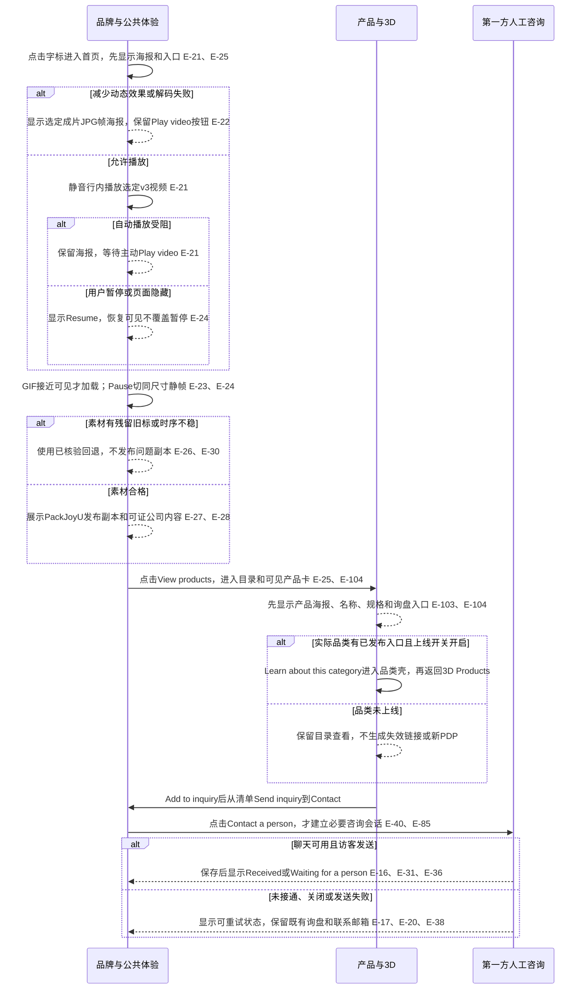
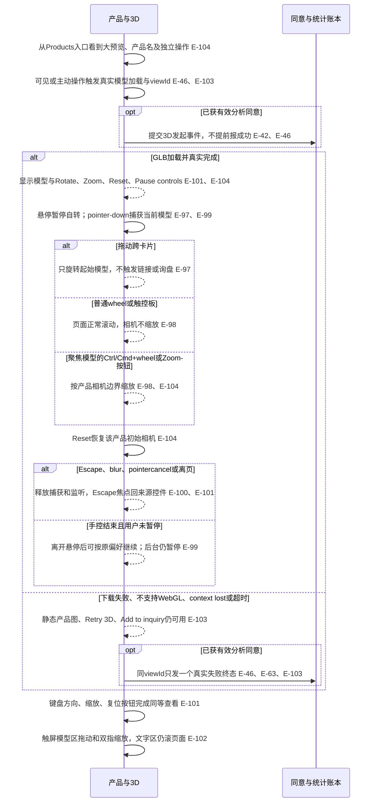
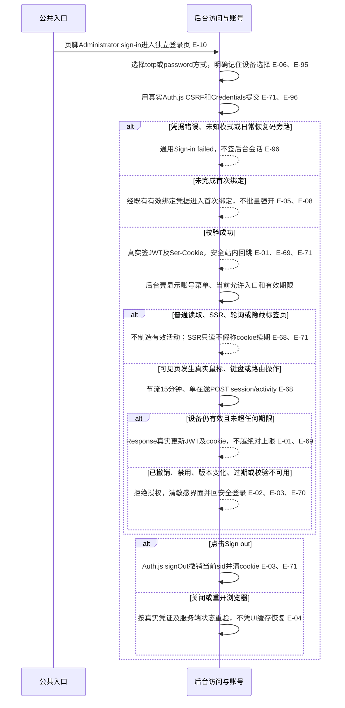
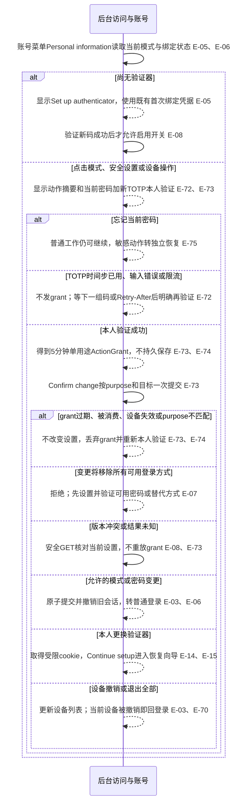
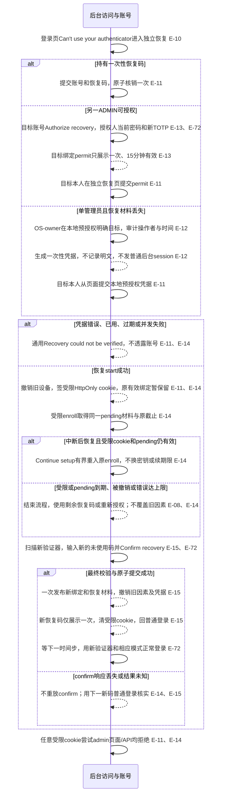
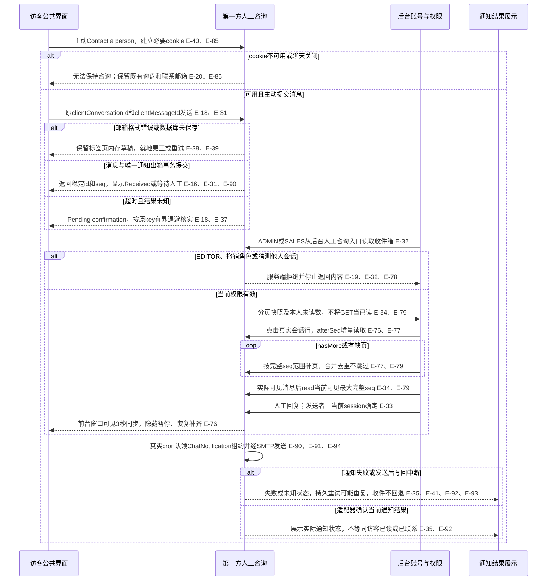
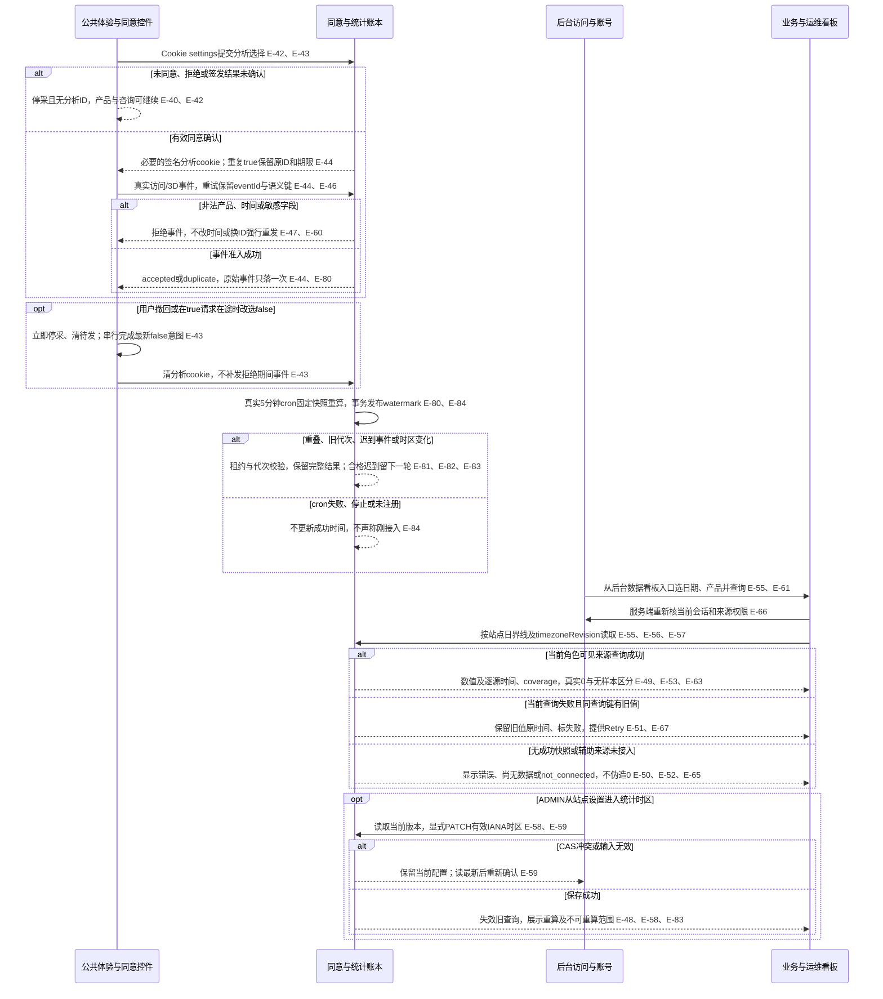

# UX

本节规定访客和运营如何完成任务、看到何种反馈以及失败后如何继续。前台使用 brand、后台使用 product/后台，沿用第11节的 `minimalist-flat`、组件和唯一 token。本节是待实施与验收的交互规格，文中目标值不是已测结果。下列七张时序图以可编辑 Mermaid 保存，参与方沿用第06节模块 ID，步骤引用边界台账，由阅读器显示图形。

## 入口与完成条件

所有路径从第07节的可见入口进入。公开页的字标、Products、About、Request a quote、页脚 Privacy policy 和管理员登录均可通过键盘到达；后台壳提供当前角色可见的个人信息、设备、人工咨询、数据看板、站点设置和账号权限入口。登录、首次绑定、恢复三页互相提供明确返回入口。参数页必须从真实产品品类卡或会话行进入，不能用直接导航终点证明菜单已接通。

访客完成条件是能看到产品、控制模型或使用静态回退，并通过既有询盘或人工咨询收到真实收件结果。运营完成条件是实际登录并可按权限继续工作、完成安全设置或受限恢复、收发咨询、理解有时间与来源的真实统计。未改的文章、solutions、factory、cases 等页面继续使用原路由；about、privacy、品类页仍遵守原发布/内容完整度及 `categoryPagesLive` 开关。品类壳保留返回 3D Products 的入口，不扩成完整单产品 PDP。

## 关键流程

### 1. 首页媒体到产品与人工咨询

首页先呈现有尺寸的海报、PackJoyU 字标、标题和产品/联系控件。视频为静音行内播放，播放与暂停均可见；不以自动播放成功作为进入产品的条件。GIF 在接近可见时才设置动态资源地址，暂停、离开视区或标签页隐藏时改用同尺寸静帧；恢复可见保留用户的暂停选择。减少动态效果时视频/GIF/模型默认静态，用户仍可主动播放或操作。页面消费04节选定的工业PNG/GIF、v3视频及对应帧海报，复核现有成品而不重做历史参考素材。公司内容仅用己方可证事实，发布媒体须通过实际文件及品牌复核，未通过的副本不进入页面。

主页视频区域不会遮挡导航、询盘入口或产品模型。v3约12.3秒，精确时刻依选定记录与实测；海报取该成片，工业插画不冒充实拍海报。参考PDF仅可作可选的历史组织/产品主题依据，不作新图底图，其认证、产能和工厂数据不能改名后成为己方介绍。制作以实际授权渠道记录和产物核验为准，不要求已确认素材补做Dot；新增公司图稿仍须真实可编辑工程、双语alt及事实证据，页面规格不充当制作证明（E-26–E-30）。

### 2. PC 直接操控、触屏与模型失败回退

产品预览区域扩大，删除底部重复介绍，保留名称、必要规格、品类链接和询盘按钮。几何卡片与模型预览区均不做 hover scale。鼠标进入模型暂停自动旋转并显示简短操作提示；在模型视口内按下即由该模型取得 pointer capture，拖过其他卡片仍只操作起始模型。卡片链接和询盘按钮是独立命中区域，拖动结束不触发点击。

普通滚轮和触控板始终滚动页面。只有模型控制区已聚焦时的 Ctrl/Cmd + wheel 或可见 Zoom in / Zoom out 按钮才缩放相机；拦截仅作用于该模型的修饰键缩放手势，其他区域保留浏览器行为。Escape、窗口失焦、pointercancel、卸载和切页均释放捕获及监听。该输入规则适用于共用 Canvas 内的每个产品视口，不能靠鼠标移过另卡改变 activeSlug。

模型控制区提供有名称的向左/右/上/下旋转、Zoom in、Zoom out、Reset view、Pause rotation 和 Finish controls。键盘聚焦控制区后方向键调整朝向，按钮提供相同功能；Tab 正常离开，Escape 结束操作并回到来源控件。触屏仅模型操作区接管单指拖动，双指缩放受相机边界约束，文字与按钮区不设全卡 `touch-action:none`。所有触控目标至少 44×44 CSS px。用户主动暂停和减少动态效果不会被重新可见覆盖（E-99–E-102）。

真实 GLB 与程序化 FoldBox 演示、海报回退要按实际结果区分。重试是新的明确查看动作，使用新的 viewId；同次加载成功、失败、超时只接受一个终态，不因重新渲染重复上报。源码中的悬停缩放和共用 Canvas 只是复现输入；是否为当前故障根因，须由旧版失败和修复后通过的真实操控记录证明。

### 3. 实际登录、活动续期、退出与撤销

页脚“管理员登录”进入独立登录页，日常默认显示 Account、Authenticator code、Remember this device 和 Sign in；Password sign-in 切到账号、密码和验证器码方式。账号须本人已启用无密码模式才接受前一种方式，界面不查询匿名账号的模式。恢复码不出现在日常登录表单；未知账号、未启用模式、未知 mode 和旧普通 Credentials 携非空 recoveryCode 均给通用失败，不泄露账号存在性。验证器码保留为六位字符串，不吞前导零。

未勾选记住设备采用有真实活动才滑动的 2 小时策略；勾选采用 7 天闲置、首次签发后 30 天绝对上限。rememberDevice 的字面 false、缺值和布尔 false 都是普通策略，其他非法值拒绝（E-01–E-04、E-95）。登录成功默认回 `/admin/stats`，合法 callback 还须对当前角色可见，不能把 EDITOR 固定送进询盘页。

activity 超时不能自动重放，页面显示期限待确认，通过账号或 Auth.js 安全读取核对当前截止；只有后续新的真实前台活动才产生新 activity。普通退出当前设备不要求新鲜本人验证；退出其他设备或全部设备进入下一流程。验收记录初登、activity、SSR 和退出各自的真实 JWT、Set-Cookie 期限与服务端撤销效果，不能把 React expires 标签、session.update 或静态 SSR 当成续期修复（E-68–E-71）。

### 4. 个人信息、模式开关与安全设备操作

从后台账号菜单“个人信息”读取当前设置，开关初值以服务端 AccountDTO 为准。日常无密码登录只需账号和验证器码；改变登录模式、密码、验证器、恢复材料及设备安全设置时，单独弹出新鲜验证表单，要求当前密码和新的未使用 TOTP，换取 5 分钟、绑定本人/当前设备/动作的单用途 ActionGrant。两个表单的目的与字段不能混在一起。

登录、reauth 或其他操作刚消费的 TOTP 时间步不能再换 grant，显示“Wait for the next authenticator code”，不把它误报为账号密码错误。密码/TOTP 提交结束即清空。reauth 响应丢失意味着未取得可用授权；先核当前账号有效，再等待下一枚未使用码并由用户重新提交，不能读回旧 grant 或自动消费第二次。未知的模式变更结果先安全读取；已退出则按预期方式重新登录核实，不以超时直接宣称成功或失败（E-72–E-75）。

已登录设备从个人信息“Signed-in devices”进入，分页只列本人设备并标当前、有效截止和撤销状态。指定设备“Sign out this device”以及“Sign out all devices”先说明影响范围，再换目标绑定授权；撤销当前设备后清空后台快照并回登录。后台普通轮询、会话列表刷新和读状态不能延长授权期限。

### 5. 首次绑定与独立受限恢复

首次绑定入口接受已有一次性绑定凭据，保留既有 enroll/confirm 协议；新验证器成功前不开无密码默认。独立恢复从“Can't use your authenticator?”进入，只请求账号与恢复码/授权凭据。另一管理员从账号权限目标行“Authorize recovery”进入新鲜验证，签发绑定目标的一次性 permit，不能自授权。没有第二管理员且恢复材料丢失时，页面说明联系服务器所有者；所有者必须在具操作系统管理权限的本机执行审计恢复命令，网页不能自行生成该权限。

受限恢复只允许重绑，不能浏览后台、改角色或成为 Auth.js 普通会话。本人新鲜验证发起的更换验证器以 SELF_REAUTH 受限 cookie 直接进入 enroll，跳过恢复 start。恢复 start 超时不自动消耗另一枚码；已有有效受限 cookie 才能继续原 enroll，无有效 cookie 才取得新恢复凭据。受限 enroll 仅在原窗口内最多一次网络重试，保留同一密钥及原 expiresAt；confirm 不自动重试。恢复中断不能提前删除原有效绑定和密码。

新恢复码只在最终确认成功响应中显示一次，并提示“Save these recovery codes now. They won't be shown again.”，不自动下载、写浏览器存储或写日志。若 confirm 响应丢失，使用刚绑定验证器下一时间步正常登录核实；本地预授权含改密时使用其新密码。未收到恢复码不能再次 confirm 取回旧码，只能正常登录后经新鲜验证重新受限重绑；忘记现密码则走独立 OS-owner 预授权，不能把“仍有无密码会话”当作改密授权（E-14、E-15、E-75）。

### 6. 访客发起、运营回复、补齐与通知

访客主动点“Contact a person”才加载聊天包并签必要 cookie；不因分析拒绝关闭咨询，也不在仅浏览 Contact 页时建会话。窗口说明是人工服务，可离线留言，不显示没有真实来源的在线绿点。首次发送与后续发送各有稳定动作 UUID；只有收到持久化结果才显示 Received。可选邮箱不是身份凭据，不能用同邮箱找回旧咨询。关闭窗口只停 UI 和轮询，不删除 cookie 或改分析偏好。

消息发送网络/408/429/5xx 可按原 UUID 和原载荷以 1/2/4 秒最多重试 3 次，429 尊重 Retry-After；幂等冲突不偷偷换 key。首次 cookie bootstrap 响应丢失不循环创建，未确认必要会话前不发消息；下一次明确联系才允许新建。401/403/404、已关闭、已匿名化与身份失效停止旧线程，不把草稿自动重发到新咨询。消息草稿和可选邮箱仅在当前标签页内存，刷新、关闭、崩溃后不保证保留（E-18、E-37–E-40）。

可见窗口正常 3 秒增量轮询，隐藏/关闭暂停，恢复立即补齐；连续失败按 1/2/4/8/16/30 秒退避，始终单在途。按消息 id/seq 合并，旧响应不倒退游标，切线程后中止并忽略旧回调。没有加载完整的范围不推进；收件箱整页快照不是正文增量日志。GET 不代表客服阅读：read 只推进到当前实际可见的完整消息最大 seq，新到但未展示的消息仍未读，不能用后台轮询制造“客服在线”或“已读”（E-33、E-34、E-76–E-79）。

运营可从正文“Close conversation”关闭线程，携当前 expectedVersion；冲突读最新状态后再确认，不自动覆盖。关闭后历史只读，访客可明确“Start a new conversation”，旧草稿不自动跨会话发送。必要 cookie 为 7 天闲置/30 天绝对期限，到期不能访问旧线程；内容仍在 90 天策略内时 ADMIN/SALES 可继续按权处理。90 天按成功咨询收发计，轮询、read、通知重试不续期；清理与新收发并发须重检活动和策略版本。本规格只授权设计、实现及隔离测试，生产、恢复和备份实际不可逆清理仍须另行明确授权，不连带改变既有询盘或分析策略（E-85–E-89）。

通知与收件分开：ChatNotification 专属出箱随消息事务保存，messageId 唯一，真实 cron 重启后可继续消费；过期租约可重新认领，旧 worker 不能覆盖新代次。SMTP 是至少一次尝试，稳定 Message-ID 只能减少重复，不能宣称精确一次送达。运营仍可处理已接收咨询，通知失败不把消息变回未发送，也不泄漏邮箱或正文到看板（E-35、E-41、E-90–E-94）。

### 7. 分析同意到真实看板与时区变更

Cookie 设置明确区分“必要人工咨询”和“可选匿名分析”。访客未同意时网站、视频、模型与咨询仍可用，不生成分析 ID 或补发历史访问；同意请求确认成功后才采集白名单事件。看板用“Consenting visitors”表达授权匿名浏览器数，不声称跨设备唯一真人；PV、产品访问、3D 发起/成功/失败分别解释。所有时间与日期控件明示站点 IANA 时区，初始 UTC，不跟随查看者操作系统时区。

同意写请求串行执行并保留最新意图；true 在途时选 false 立即停采并清队列，待请求结束再发送 false，旧 true 响应不能恢复采集。已有有效同意重复 true 不换身份、不续期；首次/已失效签发结果未知时不循环创建身份。无有效同意的事件 403 后停采。事件去重与按日聚合分开，真实新访问可增 PV，同浏览器同日 UV 不随刷新增加；不同浏览器/设备可能计多个授权访客（E-42–E-47）。

后台手动 Refresh 只安全读取统计，不调用 cron。每卡保留自身 `dataThrough`、`lastSucceededAt`、`queriedAt`、来源状态和覆盖范围；查询时间不是数据已更新的证明。核心授权访客/PV/产品/3D 必须真实接通；存储/备份等辅助 DataSource 未配置可显示 not_connected。成功 0、无样本、首次尚无数据、未接入、无快照失败、有旧值、重算和部分覆盖均不可互换（E-49–E-54、E-61–E-67）。

ADMIN 可见全部授权来源；SALES 仅业务聚合，EDITOR 仅公开流量与 3D；浏览器不先拿全量再隐藏。角色变化或账号失效清旧快照，服务端拒绝越权来源。查询键包含账号/角色、日期、产品、sources、timezoneRevision；换键清空旧值，同键失败才保留 lastGoodSnapshot。时区变更后重读新 revision，历史不可重算部分保留原时区标签或明确范围；夏令时按真实 23/25 小时日界线，午夜左闭右开，不用固定 24 小时。原始 30 天、聚合 13 个月范围外不伪造明细或零值（E-48、E-55–E-60、E-80–E-84）。

## 交互反馈与恢复控件

下表引号为英文界面默认文案，俄语版在 `messages/ru.json` 提供同义本地化；错误 code 不直接当文案。状态通过文字、图标与语义同时表达，颜色只是补充。每个反馈都由真实本地状态或第10节响应驱动，不使用固定数值和假进度。

| 场景/状态 | 可见控件与请求触发 | 文案和反馈 | 恢复动作及边界 |
|---|---|---|---|
| 首次访问/视频待播放 | Play video；静音行内媒体事件 | 海报稳定占位，按钮说明静音 | 自动播放受阻、减少动态效果、解码失败均可主动播放；不阻塞导航 E-21、E-22 |
| GIF未可见/暂停 | 可见后加载；Pause animation/Resume animation | 静帧保持尺寸和主体，暂停文字可见 | 离视区/隐藏切静帧，保留用户暂停意图 E-23–E-25 |
| 模型加载/操作 | Operate 3D、旋转/缩放/Reset view、Finish controls | “Loading 3D…”；“Drag to rotate. Scroll the page; Ctrl/Cmd + wheel to zoom.” | 不做hover scale；Escape可退出，按钮不等待自动旋转 E-97–E-104 |
| 模型失败/不支持 | Retry 3D、Add to inquiry | “3D preview unavailable. You can still view this product and contact us.” | 产品静态图和名称保留，不能把演示当GLB成功 E-103 |
| 登录提交/失败 | Sign in；真实Auth.js signIn | 提交中禁重复；“Sign-in failed. Check your details and try again.” | 保留账号和模式，清密码/TOTP；通用失败不枚举；恢复独立入口 E-10、E-96 |
| 会话过期/撤销 | 当前请求401；重新登录链接 | “Your session has ended. Sign in again to continue.” | 清敏感内容、取消轮询，保留合法站内回跳；不以后台活动复活 E-02、E-03、E-70 |
| 会话活动结果未知 | activity超时；安全GET核对 | “Session expiry could not be confirmed.” | 不自动重放activity，不改UI期限假称已续 E-68–E-71 |
| 敏感设置首次/等待验证码 | Confirm identity；reauth | “Enter your current password and a new authenticator code.”；已用步提示等待下一组 | 日常无密码表单不增加密码；忘密码转独立恢复 E-72、E-75 |
| 单用途授权失效/冲突 | 变更返回action_grant_invalid/版本冲突 | “Verify your identity again.”或“Settings changed. Review the latest values.” | 丢grant或安全重读后显式确认，不自动重放 E-08、E-73、E-74 |
| 恢复待确认/过期 | Continue setup、Confirm recovery；受限enroll/confirm | 显示原expiresAt；“This recovery session has expired.” | 有效窗口仅重入原材料；过期重新独立授权，不能进入admin E-11、E-14 |
| 恢复成功/响应未知 | 保存恢复码提示、Return to sign in | 成功一次展示；未知：“We couldn't confirm the result. Try signing in with your new authenticator code.” | 下一时间步普通登录核实；不重复confirm取码 E-15、E-72 |
| 聊天首次/离线 | Contact a person、Send message、可选Email | “Leave a message for our team.”；“Email is optional.” | 主动联系才bootstrap；必要cookie与分析独立 E-36、E-39、E-40 |
| 消息发送/待确认 | Send message；原动作UUID请求 | “Sending…”；超时“Pending confirmation” | 只在当前标签页留草稿，原key有界重试 E-18、E-37、E-38 |
| 已接收/等待人工 | 稳定id/seq收件响应 | “Received”或“Received. Waiting for a person.” | 与已读、在线、邮件结果区分，保存失败不得出现 E-31、E-35、E-36 |
| 无消息/收件箱空 | 查询成功空items；筛选控件 | “No conversations yet.”或“No conversations match these filters.” | 清筛选可回全列表；失败不显示空态 E-34、E-52 |
| 同步中断/补齐 | Retry sync、恢复可见增量GET | “Reconnecting…”；保留已确认消息 | 单在途、最大30秒退避；不把未展示消息标read E-76–E-79 |
| 聊天失效/关闭 | Start a new conversation；明确新动作 | “This conversation is no longer available.”或“This conversation is closed.” | 旧线程只读或停止，草稿不自动跨线程发；同邮箱不恢复身份 E-78、E-85、E-89 |
| 通知失败/未知 | 收件箱通知状态与ADMIN授权计数 | “Message received. Notification failed.”或“Notification status unknown.” | 收件不撤回，持久出箱恢复；不能显示已送达/已读 E-35、E-41、E-90–E-94 |
| 分析未知/拒绝/撤回 | Cookie settings的Allow analytics/Reject analytics | “Anonymous analytics is optional.” | 即刻停采和清待发，聊天仍可用，不补发历史 E-40、E-42、E-43 |
| 看板加载/成功0 | 日期/产品查询、Refresh | 固定卡尺寸骨架；成功后“0”及实际数据/查询时间 | 只有成功统计可显示0；不把无样本当0% E-49、E-63 |
| 首次尚无数据/未接入 | 来源状态和范围说明 | “No data yet.”；“Not connected: [source].” | 核心流量/3D验收不能用未接入充完成；辅助源说明配置来源 E-50、E-61、E-65 |
| 查询失败/保留旧值 | Retry按钮；同键GET | “Couldn't refresh. Showing data through [time].” | 时间不重置；无快照显示错误而不填0，其他卡继续工作 E-51–E-54、E-67 |
| 时区重算/部分覆盖 | ADMIN站点设置、原version提交 | “Recalculating in [timezone].”；“Only part of this period can be recalculated.” | 冲突取最新、不静默覆盖；旧revision有标识 E-55–E-60、E-83 |
| 限流/权限拒绝 | 受控错误及Retry-After | “Try again after [time].”或“You don't have access to this area.” | 等待后仅按端点规则重试；403停止取敏感内容，不能只改菜单 E-19、E-32、E-66 |
| 一次性写结果未知 | 取消等待或15秒超时 | “The result couldn't be confirmed.”，保留安全requestId | 安全GET核状态；没有可核结果时普通登录/独立恢复，不自动重放第10节限制动作 |

## 文案原则

动词说明实际下一步：Play video、View products、Add to inquiry、Contact a person、Send message、Verify identity、Reset view，避免只有“继续”而不说明发生什么的关键按钮。普通取消只关闭弹层/等待，不声称回滚服务端已经提交的动作。修改密码、登录方式、验证器和退出全部设备的确认文案明确影响范围与重新登录要求。

沿用用户熟悉的“2FA”时，同时解释无密码方式为“Account + authenticator code”，账号标识不是第二个独立验证因素；不宣传该模式具有密码加验证器的双因素等级。正常登录不提示必须备恢复码，恢复入口说明一次性用途。设备期限、5分钟授权和恢复期限用服务端时间表示，不把前端倒计时当权限判定（E-09、E-69、E-74）。

成功文案对应已观察事实：Received 是已保存，Read 只在真实读标记后，通知只按其实际状态，SMTP 接受也不保证访客邮箱最终送达。看板说明“授权匿名浏览器”、站点时区、覆盖期、数据截止和来源；无流量不能推出全链路健康，没有真实心跳不显示 Healthy。表单错误说明可更正字段，认证失败保持通用，不回显原始数据库、SMTP、内部路径或堆栈；安全 requestId 可供排查。

## 可访问性与输入基线

使用原生 button、a、label、input、fieldset、dialog、table 等语义及现有焦点能力。交互名称明确到对象，例如“Reset view: [product name]”和“Sign out device: [safe device label]”。不把整张包含多个动作的卡片做成嵌套链接或单一无语义点击区；Canvas 提供文字说明、静态图和可达按钮，不要求读屏理解像素。

| 范围 | 键盘、焦点与ARIA要求 | 必验失败/恢复 |
|---|---|---|
| 页面与后台壳 | Skip to content；标题层级连续；导航有current状态；折叠菜单button用aria-expanded/aria-controls | 缩窄、200%缩放、en/ru长文案仍能到达主内容和退出；不出现整页横向滚动 |
| 模型 | 可命名控制区和文字操作说明；方向/缩放/复位/暂停有相同按钮功能；焦点可见且Tab不被捕获 | Escape回来源控件；失焦/取消/卸载释放输入；触屏44px目标 E-100–E-104 |
| 媒体 | Play/Pause名称反映真实状态；GIF暂停用静帧而非隐藏动态像素；装饰图空alt、内容图描述实际内容 | 系统减少动态效果或用户暂停优先；视频信息提供页面文字摘要，不靠有声视频传达必需步骤 E-21–E-25 |
| 登录与安全表单 | 可见label；账号autocomplete=username，密码current-password/new-password，TOTP one-time-code及inputmode=numeric；可粘贴完整6位码 | 首错误通过aria-describedby/aria-invalid关联，提交错误摘要聚焦一次；不自动提交或阻止密码管理器 E-08、E-96 |
| 对话框/恢复向导 | dialog有标题和说明；打开焦点到说明或首字段，关闭回触发控件；正常Tab仅在当前模态中循环 | Escape可关闭未提交弹层；秘密展示不进aria-live自动朗读；到期清秘密并给可达新授权入口 E-14、E-74 |
| 聊天 | 消息列表role=log、适度polite播报新消息，不反复朗读历史补页；发送状态与错误独立关联编辑器 | 新消息不抢焦点/强拉到底；上翻阅读时显示New messages按钮，点击才滚；read仅实际可见范围 E-34、E-79 |
| 看板/表格 | 图表有标题、单位、时区、文字摘要及同DTO可读表格；排序/筛选为具名控件；状态文字不只颜色 | 局部刷新aria-busy，完成polite播报摘要；旧值、无样本、错误均可读，角色拒绝清敏感数据 E-49–E-67 |
| 共用状态 | 非文本控件/焦点与背景至少3:1，普通文字至少4.5:1，大字至少3:1；焦点不被固定栏遮挡 | token变化后复核所有hover/focus/disabled/error组合；高对比和减少动态效果下不丢状态含义 |

提交开始给当前按钮 busy 和重复提交保护，不把整页设不可操作；等待期间可返回安全页面。身份校验失败清秘密字段并把焦点留在当前错误上下文；网络变化和轮询不自行跳焦点。`aria-live` 不朗读密码、TOTP、恢复码、授权 token、邮箱或聊天历史全文；秘密不进入 URL query、localStorage、sessionStorage、IndexedDB、日志或埋点。

## 响应与感知性能目标

下表是实施需要测量的目标与固定协议，不是现有页面性能结论。测量在真实服务、实际媒体和已加载样式下执行，注明设备、网络、视口和缓存条件；第11节的尺寸/容器与桌面密度另行执行。

| 操作 | 目标与可感知反馈 | 超时、离开与恢复 |
|---|---|---|
| 按钮、模式开关、对话框、模型控制 | 本地输入反馈目标100ms内；不等待网络才显示按下/忙碌；模型操作中目标保持可用、无明显输入积压 | 取消/失焦释放监听，禁止为掩盖卡顿加hover放大；真实拖动记录PC1440/1920及窄屏 E-97–E-104 |
| 公开首屏 | 优先SSR标题、海报、名称与联系入口，预留媒体尺寸；目标p75 LCP≤2.5s、INP≤200ms、CLS≤0.1 | 模型/视频/GIF/聊天按需分包和装载，失败不阻塞主任务；目标未达保留实测原因，不虚报通过 |
| 普通接口 | 沿第10节15s客户端截止；加载时有局部busy/骨架，不用虚假百分比 | 离页Abort取消客户端等待；不等于回滚已提交事务；幂等与一次性写严格按第10节分流 |
| 消息保存 | 发出即显示Sending，收到持久化结果才Received | 15s结果未知显示Pending confirmation，按原key 1/2/4s最多3次，429遵Retry-After；非可重试错误停发 |
| 新消息发现 | 可见正常3s轮询；hasMore立即有界补页；隐藏/关闭零轮询，恢复可见立即补齐 | 连续失败1/2/4/8/16/30s退避、单在途；状态文案不承诺毫秒实时或客服在线 E-76–E-79 |
| 会话活动 | 真实可见活动后按15min节流且单在途，期限只采用服务器返回 | 不用定时器、GET/SSR、聊天轮询续闲置；结果未知只安全读取，不重放activity E-68–E-71 |
| 看板刷新 | 查询期间同键逐源保留已标旧值；目标让日期/产品控件持续可操作 | 换查询键取消旧请求，旧响应不得覆盖新键；首次失败无0占位，局部失败不拖垮其他源 E-51、E-53、E-67 |
| 聚合数据更新 | 正常调度每5min一轮，页面展示真实watermark和覆盖范围 | 故障/未注册/重启后未成功均显示旧值或未知；手动GET不假装触发作业 E-80–E-84 |

## 交付时保留的验证证据

第17节的验收须沿上述可见入口，在真实服务器与浏览器串起控件、请求、响应和可见结果。每条失败恢复记录实际前置状态、E 编号、动作和结果；GUI 行为提供真实流程 GIF，PC 至少覆盖 1920×1080、1440×900，再覆盖窄屏、键盘、触屏和减少动态效果。媒体装载需网络证据，不能以 display:none 证明未下载；素材来源与远程制作需真实记录，原附件保持原位。

认证证据分别保留锁定 Auth.js beta 的初登、主动 activity、SSR、signOut 与设备撤销拒绝；敏感设置和恢复验证同 TOTP 时间步重用、grant跨用途/过期、受限cookie进admin失败、最终原子重绑及旧凭据拒绝。聊天用真实访客和ADMIN/SALES双端，验证EDITOR拒绝、幂等重试、补页/乱序、实际可见read、离线与通知失败、cron重启消费。统计通过真实同意、事件去重、实际五分钟调度、聚合watermark、不同角色查询和旧值展示，不能只手工调用聚合端点。

静态 SSR、存储注入、直接数据库写业务数值、固定应答、日志截图或单独API成功均不能代替完整产品链路。容量不足、辅助来源未接入、远程制作未执行、真实调度未注册和核心路径失败须如实保留未完成项；不能用改UI标签或默认0关闭问题。

## 登录链的实施阶段

最终用户仍按本节从页脚进入统一登录页并默认到真实数据看板。实施先在既有Auth.js密码+TOTP登录链上交M3-T7壳与活动客户端，再交M6-T4看板，最后由M3-T6注册自定义登录页；测试必须点击到已存在目标，不能以404充当登录成功。此顺序不新增业务状态、页面或登录方式。
