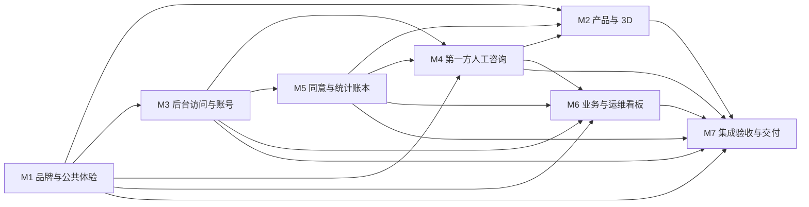

# PackJoyU　项目知识库

> 这是本项目的入口。**任何人或模型要动这个项目，从这一页开始。**

## 查东西去哪

| 你想知道 | 去哪 |
|---|---|
| 项目干什么、不干什么 | [[01-概述与目标]]、[[02-非目标]] |
| 用什么技术、否掉过什么 | [[05-技术栈]] |
| 某个模块负责什么、代码在哪 | `图谱/模块/<模块ID>.md` |
| 某个任务怎么做、做完没有 | `图谱/任务/<任务ID>.md` |
| 某种异常该怎么处理 | `图谱/边界/<边界ID>.md` |
| 代码怎么摆、分几层 | [[07-前端架构]]、[[08-后端架构]] |
| 接口长什么样 | [[10-接口约定]] |
| 界面该长什么样 | [[11-UI]]、[[12-UX]] |
| 为什么这么设计 | [[22-决策记录]] |
| 有什么风险没解决 | [[21-风险与未决事项]] |

## 规模

7 个模块 · 78 个任务 · 100.5 人天 · 105 条边界（100% 被任务覆盖）

## 模块地图

## 模块

- [[M1]]　品牌与公共体验：负责现用 PackJoyU 字标、己方可证公司内容、JPG/GIF 发布副本、首页媒体和前台公共页面，并作为全站前后台视觉 token 的唯一归属；不承担后台权限或后台外壳。　· 8 任务 · 13 人天
- [[M2]]　产品与 3D：负责产品列表、卡片和详情中的产品表达、直接模型操控、输入冲突处理、触屏与键盘查看、图片回退及带产品上下文的询盘入口。　· 8 任务 · 11 人天
- [[M3]]　后台访问与账号：负责统一后台登录页和后台公共外壳、个人设置、设备会话、验证器绑定与登录方式切换、会话撤销及独立受限恢复；消费 M1 的视觉 token。　· 20 任务 · 23 人天
- [[M4]]　第一方人工咨询：负责访客必要会话、人工消息与离线留言、ADMIN/SALES 收件箱和回复、未读、失败草稿与幂等重试，并保存真实收件和通知结果。　· 15 任务 · 16 人天
- [[M5]]　同意与统计账本：负责分析同意、匿名浏览器与事件标识、采集准入和去重、站点统计时区设置、日与产品聚合、原始与聚合保留及可重算边界，产出真实访问和 3D 统计。　· 11 任务 · 14 人天
- [[M6]]　业务与运维看板：负责按角色查询并解释统计结果，读取询盘、聊天、接口错误、邮件、存储和备份的真实来源，区分数据时间、零值、无数据、未接入、失败和旧值。　· 7 任务 · 10 人天
- [[M7]]　集成验收与交付：负责访客跨模块完整路径、后台权限与恢复路径、统计和可靠性完整链路的真实集成验收及交付证据收口；核对本轮复用的恢复来源，不重做 S1 已完成的取回和来源审计，也不自动合并恢复草稿。　· 9 任务 · 13.5 人天

## 任务（按开工批次）

同一批内互不依赖，可以并行派活；跨批必须等前面落地。

### 第 1 批　1 个 · 2 人天　（无前置依赖，可立即开工）
- [[M1-T1]]　接入8个核心品牌变量及既有路径真实冒烟

### 第 2 批　3 个 · 4.5 人天
- [[M1-T2]]　导出新增领域共享schema与DTO
- [[M1-T3]]　制作JPG换标及视频海报发布副本
- [[M1-T7]]　补齐共享视觉变量与原生UI包装

### 第 3 批　5 个 · 6.5 人天
- [[M1-T6]]　逐帧替换GIF品牌并校验发布媒体集合
- [[M1-T8]]　接通统一fetch取消与错误适配
- [[M2-T4]]　定义模型分析事件生命周期纯规则
- [[M3-T14]]　接通新API配置、错误映射与脱敏计数
- [[M5-T1]]　建立JobState租约与代次仓储原语

### 第 4 批　4 个 · 4.5 人天
- [[M1-T4]]　接好首页视频与分区JPG/GIF场景
- [[M3-T1]]　将真实Auth.js会话绑定当前设备与权限
- [[M4-T15]]　移除Tawk接线并说明必要人工咨询
- [[M4-T8]]　建立主动联系才签发的必要cookie

### 第 5 批　6 个 · 8.5 人天
- [[M1-T5]]　发布可核实己方公司内容与对应入口
- [[M2-T1]]　扩展产品卡视口与精简信息区
- [[M3-T15]]　通过真实活动写回会话期限并验证四条Auth.js路径
- [[M3-T2]]　校验登录方式并原子核销当前验证器时间步
- [[M5-T2]]　接通服务端分析同意签名cookie
- [[M5-T9]]　建立版本化IANA时区与自然日仓储规则

### 第 6 批　4 个 · 5.5 人天
- [[M2-T2]]　修正模型直接拖动与滚轮焦点
- [[M3-T3]]　签发一次性新鲜本人授权
- [[M3-T7]]　统一后台外壳并只上报真实活动
- [[M5-T6]]　持久化严格白名单分析事件

### 第 7 批　6 个 · 8.5 人天
- [[M2-T3]]　接通模型键盘触屏与复位控件
- [[M3-T16]]　原子切换本人登录方式与密码
- [[M3-T17]]　提供本人设备列表及目标撤销API
- [[M3-T4]]　签发管理员目标恢复permit
- [[M5-T3]]　以一致快照重算并原子替换日聚合
- [[M5-T7]]　接通同意UI、页面事件与隐私说明

### 第 8 批　5 个 · 6 人天
- [[M2-T6]]　接通真实模型失败与海报回退
- [[M3-T18]]　提供受OS权限保护的本地恢复预授权CLI
- [[M3-T19]]　原子核销恢复码或permit为受限会话
- [[M5-T5]]　实现分析保留候选与覆盖边界计划器
- [[M5-T8]]　注册聚合作业并接通真实5分钟cron

### 第 9 批　7 个 · 8.5 人天
- [[M2-T5]]　连接产品上下文到既有询盘表单
- [[M2-T7]]　把真实GLB生命周期接入分析采集
- [[M3-T5]]　接通受限重入绑定与最终一次确认
- [[M4-T1]]　原子保存咨询首消息及唯一通知出箱
- [[M4-T12]]　注册既有邮件队列真实POST调度
- [[M5-T11]]　注册默认dry-run的分析保留任务
- [[M5-T4]]　接通时区设置HTTP与重算范围查询

### 第 10 批　5 个 · 5.5 人天
- [[M3-T20]]　将本人换验证器接入受限重绑
- [[M4-T2]]　读取访客消息页并单调推进读位置
- [[M4-T4]]　消费持久聊天通知并注册每分钟作业
- [[M5-T10]]　呈现ADMIN时区表单与保存反馈
- [[M6-T1]]　定义统计查询范围与核心来源DTO

### 第 11 批　3 个 · 3 人天
- [[M4-T10]]　幂等追加访客消息并更新咨询保留期限
- [[M4-T3]]　查询当前授权运营的收件箱及读状态
- [[M6-T6]]　接通受角色限制的真实统计HTTP入口

### 第 12 批　7 个 · 9.5 人天
- [[M4-T11]]　保存真实人工回复并关闭咨询
- [[M4-T5]]　接通访客聊天打开与消息编辑器
- [[M4-T7]]　注册聊天保留候选与默认拒绝真实清理
- [[M6-T2]]　接入询盘与聊天只读业务计数
- [[M6-T3]]　登记存储备份报告与运维采样
- [[M6-T4]]　交付可导航的核心数据看板页面
- [[M6-T5]]　接入HTTP和邮件可靠性来源

### 第 13 批　3 个 · 4 人天
- [[M3-T6]]　接通唯一登录页和明确方式字段
- [[M4-T9]]　集成聊天轮询、断网重试与失权停止
- [[M6-T7]]　完成看板逐源状态与故障呈现

### 第 14 批　6 个 · 7.5 人天
- [[M3-T10]]　接通首次绑定表单与一次展示材料
- [[M3-T11]]　接通独立恢复及受限重绑向导
- [[M4-T13]]　在隔离授权策略下原子匿名化过期咨询
- [[M4-T6]]　接通运营收件箱和只读会话页
- [[M7-T3]]　终验同意到分析看板及统计日界线
- [[M7-T7]]　终验运维来源与通知重启消费

### 第 15 批　2 个 · 3 人天
- [[M3-T12]]　接通个人安全页与共享新鲜验证对话框
- [[M4-T14]]　在真实双端会话接通人工回复与关闭

### 第 16 批　3 个 · 3 人天
- [[M2-T8]]　贯通产品咨询与人工收件回复
- [[M3-T8]]　显示本人设备并退出指定设备
- [[M3-T9]]　在账号行复用验证对话框授权恢复

### 第 17 批　2 个 · 2 人天
- [[M3-T13]]　接通退出全部设备确认与结果核实
- [[M7-T1]]　终验公开媒体与3D访客路径

### 第 18 批　3 个 · 4.5 人天
- [[M7-T2]]　终验真实会话跨路径持久与撤销
- [[M7-T4]]　终验询盘聊天闭环与容量降级
- [[M7-T6]]　终验新鲜本人授权与忘密码隔离

### 第 19 批　1 个 · 2 人天
- [[M7-T5]]　终验受限恢复与单管理员兜底

### 第 20 批　1 个 · 0.5 人天
- [[M7-T8]]　核对恢复候选的当前来源与安全批准

### 第 21 批　1 个 · 1.5 人天
- [[M7-T9]]　验收既有分发脚本与隔离备份恢复链

### 依赖全景

任务共 78 个，画成一张图会糊。去阅读器 `index.html` 概览页看可点、可高亮关键路径的交互式依赖图。

## 边界

- [[E-01]]　会话持久化与记住设备期限　→ [[M3-T1]]、[[M3-T15]]、[[M7-T2]]
- [[E-02]]　会话持久化与记住设备期限　→ [[M3-T1]]、[[M3-T15]]、[[M7-T2]]
- [[E-03]]　会话持久化与记住设备期限　→ [[M3-T1]]、[[M3-T7]]、[[M3-T13]]、[[M3-T15]]、[[M3-T16]]、[[M3-T17]]、[[M7-T2]]
- [[E-04]]　会话持久化与记住设备期限　→ [[M3-T15]]、[[M7-T2]]
- [[E-05]]　C-03 验证器绑定与无密码默认开关　→ [[M3-T2]]、[[M3-T10]]
- [[E-06]]　C-03 验证器绑定与无密码默认开关　→ [[M3-T2]]、[[M3-T12]]、[[M3-T16]]
- [[E-07]]　C-03 验证器绑定与无密码默认开关　→ [[M3-T12]]、[[M3-T16]]
- [[E-08]]　C-03 验证器绑定与无密码默认开关　→ [[M3-T2]]、[[M3-T5]]、[[M3-T10]]、[[M3-T16]]、[[M7-T6]]
- [[E-09]]　C-03 验证器绑定与无密码默认开关　→ [[M3-T6]]、[[M3-T12]]
- [[E-10]]　C-04 验证器丢失与单管理员恢复　→ [[M3-T10]]、[[M3-T11]]、[[M3-T19]]、[[M7-T5]]
- [[E-11]]　C-04 验证器丢失与单管理员恢复　→ [[M3-T11]]、[[M3-T19]]、[[M7-T5]]
- [[E-12]]　C-04 验证器丢失与单管理员恢复　→ [[M3-T11]]、[[M3-T18]]
- [[E-13]]　C-04 验证器丢失与单管理员恢复　→ [[M3-T4]]、[[M3-T9]]
- [[E-14]]　C-04 验证器丢失与单管理员恢复　→ [[M3-T5]]、[[M3-T11]]、[[M3-T19]]、[[M3-T20]]、[[M7-T5]]
- [[E-15]]　C-04 验证器丢失与单管理员恢复　→ [[M3-T5]]、[[M3-T11]]、[[M7-T5]]
- [[E-16]]　在线聊天实现路线　→ [[M2-T8]]、[[M4-T11]]、[[M4-T14]]、[[M7-T4]]
- [[E-17]]　在线聊天实现路线　→ [[M4-T5]]
- [[E-18]]　在线聊天实现路线　→ [[M4-T1]]、[[M4-T9]]、[[M4-T10]]、[[M7-T4]]
- [[E-19]]　在线聊天实现路线　→ [[M4-T2]]、[[M4-T3]]
- [[E-20]]　在线聊天实现路线　→ [[M4-T15]]、[[M7-T4]]
- [[E-21]]　主页视频、JPG、GIF加载与控制　→ [[M1-T4]]、[[M7-T1]]
- [[E-22]]　主页视频、JPG、GIF加载与控制　→ [[M1-T4]]
- [[E-23]]　主页视频、JPG、GIF加载与控制　→ [[M1-T4]]
- [[E-24]]　主页视频、JPG、GIF加载与控制　→ [[M1-T4]]、[[M7-T1]]
- [[E-25]]　主页视频、JPG、GIF加载与控制　→ [[M1-T4]]
- [[E-26]]　自己的Logo与参考PDF事实边界　→ [[M1-T6]]、[[M7-T1]]
- [[E-27]]　自己的Logo与参考PDF事实边界　→ [[M1-T5]]
- [[E-28]]　自己的Logo与参考PDF事实边界　→ [[M1-T3]]、[[M1-T5]]
- [[E-29]]　自己的Logo与参考PDF事实边界　→ [[M1-T3]]、[[M7-T1]]
- [[E-30]]　自己的Logo与参考PDF事实边界　→ [[M1-T6]]、[[M7-T1]]
- [[E-31]]　C-01 人工聊天收件与回复入口　→ [[M2-T8]]、[[M4-T1]]、[[M4-T5]]、[[M4-T6]]、[[M4-T11]]、[[M4-T14]]、[[M7-T4]]
- [[E-32]]　C-01 人工聊天收件与回复入口　→ [[M4-T3]]、[[M4-T6]]、[[M4-T11]]
- [[E-33]]　C-01 人工聊天收件与回复入口　→ [[M4-T10]]、[[M4-T11]]、[[M4-T14]]
- [[E-34]]　C-01 人工聊天收件与回复入口　→ [[M4-T2]]、[[M4-T3]]、[[M4-T6]]
- [[E-35]]　C-01 人工聊天收件与回复入口　→ [[M4-T3]]、[[M4-T4]]、[[M4-T6]]、[[M4-T12]]、[[M4-T14]]
- [[E-36]]　C-02 离线留言与发送失败恢复　→ [[M4-T5]]
- [[E-37]]　C-02 离线留言与发送失败恢复　→ [[M2-T8]]、[[M4-T9]]、[[M4-T10]]、[[M7-T4]]
- [[E-38]]　C-02 离线留言与发送失败恢复　→ [[M4-T5]]、[[M4-T9]]
- [[E-39]]　C-02 离线留言与发送失败恢复　→ [[M4-T1]]、[[M4-T5]]
- [[E-40]]　C-02 离线留言与发送失败恢复　→ [[M2-T8]]、[[M4-T1]]、[[M4-T5]]、[[M4-T8]]、[[M4-T15]]、[[M7-T4]]
- [[E-41]]　C-02 离线留言与发送失败恢复　→ [[M4-T3]]、[[M4-T4]]、[[M4-T6]]、[[M4-T12]]、[[M4-T14]]
- [[E-42]]　C-05 分析采集、去重与保留期　→ [[M2-T7]]、[[M5-T7]]、[[M7-T3]]
- [[E-43]]　C-05 分析采集、去重与保留期　→ [[M5-T7]]
- [[E-44]]　C-05 分析采集、去重与保留期　→ [[M5-T8]]
- [[E-45]]　C-05 分析采集、去重与保留期　→ [[M5-T7]]
- [[E-46]]　C-05 分析采集、去重与保留期　→ [[M2-T7]]
- [[E-47]]　C-05 分析采集、去重与保留期　→ [[M4-T5]]、[[M5-T6]]
- [[E-48]]　C-05 分析采集、去重与保留期　→ [[M5-T11]]、[[M7-T3]]
- [[E-49]]　C-06 看板数据时间与异常状态　→ [[M6-T1]]、[[M6-T7]]
- [[E-50]]　C-06 看板数据时间与异常状态　→ [[M6-T1]]、[[M6-T7]]
- [[E-51]]　C-06 看板数据时间与异常状态　→ [[M6-T5]]、[[M6-T7]]
- [[E-52]]　C-06 看板数据时间与异常状态　→ [[M6-T5]]、[[M6-T7]]
- [[E-53]]　C-06 看板数据时间与异常状态　→ [[M6-T5]]、[[M6-T7]]
- [[E-54]]　C-06 看板数据时间与异常状态　→ [[M6-T7]]
- [[E-55]]　今日统计的站点时区与历史重算　→ [[M6-T1]]、[[M6-T6]]
- [[E-56]]　今日统计的站点时区与历史重算　→ [[M5-T3]]、[[M7-T3]]
- [[E-57]]　今日统计的站点时区与历史重算　→ [[M5-T3]]
- [[E-58]]　今日统计的站点时区与历史重算　→ [[M5-T3]]、[[M5-T4]]、[[M6-T6]]
- [[E-59]]　今日统计的站点时区与历史重算　→ [[M5-T4]]、[[M5-T10]]
- [[E-60]]　今日统计的站点时区与历史重算　→ [[M5-T8]]
- [[E-61]]　运维指标扩展及角色权限　→ [[M6-T4]]、[[M6-T6]]、[[M7-T3]]
- [[E-62]]　运维指标扩展及角色权限　→ [[M6-T2]]
- [[E-63]]　运维指标扩展及角色权限　→ [[M2-T7]]、[[M6-T1]]、[[M6-T4]]、[[M7-T3]]
- [[E-64]]　运维指标扩展及角色权限　→ [[M6-T5]]、[[M7-T7]]
- [[E-65]]　运维指标扩展及角色权限　→ [[M6-T3]]、[[M7-T7]]、[[M7-T9]]
- [[E-66]]　运维指标扩展及角色权限　→ [[M6-T2]]、[[M6-T3]]、[[M6-T4]]、[[M6-T6]]
- [[E-67]]　运维指标扩展及角色权限　→ [[M6-T3]]、[[M6-T5]]、[[M6-T7]]、[[M7-T7]]
- [[E-68]]　设备会话与Auth.js期限接合　→ [[M3-T7]]、[[M3-T15]]
- [[E-69]]　设备会话与Auth.js期限接合　→ [[M3-T1]]、[[M3-T15]]、[[M7-T2]]
- [[E-70]]　设备会话与Auth.js期限接合　→ [[M3-T1]]、[[M3-T7]]、[[M3-T8]]、[[M3-T15]]、[[M3-T17]]、[[M7-T2]]
- [[E-71]]　设备会话与Auth.js期限接合　→ [[M3-T15]]、[[M7-T2]]
- [[E-72]]　敏感设置的新鲜本人验证　→ [[M3-T2]]、[[M3-T3]]、[[M3-T12]]、[[M7-T6]]
- [[E-73]]　敏感设置的新鲜本人验证　→ [[M3-T3]]、[[M3-T4]]、[[M3-T8]]、[[M3-T9]]、[[M3-T12]]、[[M3-T13]]、[[M3-T16]]、[[M3-T17]]、[[M7-T6]]
- [[E-74]]　敏感设置的新鲜本人验证　→ [[M3-T3]]、[[M3-T12]]、[[M3-T13]]、[[M3-T16]]、[[M3-T17]]、[[M7-T6]]
- [[E-75]]　敏感设置的新鲜本人验证　→ [[M3-T3]]、[[M3-T4]]、[[M3-T12]]、[[M3-T18]]、[[M3-T20]]、[[M7-T6]]
- [[E-76]]　人工聊天同步机制　→ [[M4-T6]]、[[M4-T9]]
- [[E-77]]　人工聊天同步机制　→ [[M4-T2]]、[[M4-T6]]、[[M4-T9]]
- [[E-78]]　人工聊天同步机制　→ [[M4-T3]]、[[M4-T6]]、[[M4-T9]]、[[M4-T10]]、[[M4-T11]]、[[M4-T14]]
- [[E-79]]　人工聊天同步机制　→ [[M4-T2]]、[[M4-T3]]、[[M4-T6]]
- [[E-80]]　分析聚合与水位发布　→ [[M5-T3]]
- [[E-81]]　分析聚合与水位发布　→ [[M5-T3]]、[[M5-T8]]、[[M7-T3]]
- [[E-82]]　分析聚合与水位发布　→ [[M5-T3]]、[[M5-T11]]
- [[E-83]]　分析聚合与水位发布　→ [[M5-T3]]
- [[E-84]]　分析聚合与水位发布　→ [[M5-T8]]
- [[E-85]]　聊天凭据及数据保留期限　→ [[M4-T2]]、[[M4-T5]]、[[M4-T7]]、[[M4-T8]]、[[M4-T9]]
- [[E-86]]　聊天凭据及数据保留期限　→ [[M4-T3]]、[[M4-T7]]、[[M4-T10]]、[[M4-T13]]
- [[E-87]]　聊天凭据及数据保留期限　→ [[M4-T13]]
- [[E-88]]　聊天凭据及数据保留期限　→ [[M4-T7]]、[[M4-T13]]、[[M7-T3]]
- [[E-89]]　聊天凭据及数据保留期限　→ [[M4-T3]]、[[M4-T13]]
- [[E-90]]　聊天通知持久队列　→ [[M4-T1]]、[[M4-T4]]、[[M4-T10]]
- [[E-91]]　聊天通知持久队列　→ [[M4-T4]]
- [[E-92]]　聊天通知持久队列　→ [[M4-T4]]
- [[E-93]]　聊天通知持久队列　→ [[M4-T4]]
- [[E-94]]　聊天通知持久队列　→ [[M4-T4]]、[[M4-T12]]、[[M7-T7]]
- [[E-95]]　登录记住设备字段　→ [[M1-T2]]、[[M3-T6]]、[[M3-T15]]
- [[E-96]]　登录方式枚举与账号隐私　→ [[M3-T2]]、[[M3-T6]]、[[M7-T2]]
- [[E-97]]　模型拖动所有权　→ [[M2-T2]]
- [[E-98]]　页面滚动与缩放　→ [[M2-T2]]
- [[E-99]]　自动旋转与用户意图　→ [[M2-T2]]
- [[E-100]]　失焦与取消　→ [[M2-T2]]
- [[E-101]]　键盘模型查看　→ [[M2-T3]]
- [[E-102]]　触屏手势　→ [[M2-T3]]
- [[E-103]]　真实模型失败与统计　→ [[M2-T7]]
- [[E-104]]　产品复位与显示　→ [[M2-T3]]、[[M7-T1]]
- [[E-105]]　恢复候选代码的来源与发布边界　→ [[M7-T8]]

## 章节目录

**概览**
[[01-概述与目标]]　[[02-非目标]]　[[03-术语表]]

**约束**
[[04-开发条件]]　[[05-技术栈]]

**设计**
[[06-系统架构与模块划分]]　[[07-前端架构]]　[[08-后端架构]]　[[09-数据模型]]　[[10-接口约定]]　[[11-UI]]　[[12-UX]]

**质量**
[[13-边界问题与异常处理]]　[[14-安全与权限]]　[[15-性能与容量假设]]　[[16-可观测性]]　[[17-测试策略]]

**执行**
[[18-部署与运维]]　[[19-模块任务拆分]]　[[20-里程碑与交付顺序]]　[[21-风险与未决事项]]

**附录**
[[22-决策记录]]　[[23-变更记录]]　[[24-参考资料]]

---

_`图谱/` 下的笔记由 `build_vault.py` 从 24 节的表格派生。改这些笔记的正文没用，下次重跑会被覆盖——要改内容请改对应章节的表格，再重跑脚本。只有「代码位置」「实施沉淀」「验证记录」这几段是受保护的，重跑不动它们。_
