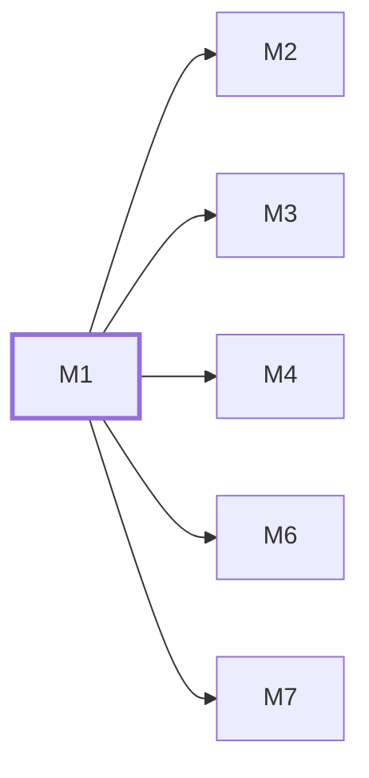

# M1　品牌与公共体验：负责现用 PackJoyU 字标、己方可证公司内容、JPG/GIF 发布副本、首页媒体和前台公共页面，并作为全站前后台视觉 token 的唯一归属；不承担后台权限或后台外壳。

## 依赖关系

- 本模块依赖：无，可最先开工
- 被依赖：[[M2]]、[[M3]]、[[M4]]、[[M6]]、[[M7]]

## 下辖任务（9 个 · 15 人天）

| 任务 | 标题 | 预估 | 覆盖边界 |
|---|---|---|---|
| [[M1-T1]] | 接入8个核心品牌变量及既有路径真实冒烟 | 2d | — |
| [[M1-T2]] | 导出新增领域共享schema与DTO | 1.5d | [[E-95]] |
| [[M1-T3]] | 制作JPG换标及视频海报发布副本 | 1.5d | [[E-28]]、[[E-29]] |
| [[M1-T4]] | 接好选定视频与分区PNG/GIF场景 | 1.5d | [[E-21]]、[[E-22]]、[[E-23]]、[[E-24]]、[[E-25]] |
| [[M1-T5]] | 集成己方公司内容与选定图稿 | 2d | [[E-111]]、[[E-27]]、[[E-28]]、[[E-29]] |
| [[M1-T6]] | 核验已确认GIF及发布媒体集合 | 2d | [[E-26]]、[[E-30]] |
| [[M1-T7]] | 补齐共享视觉变量与原生UI包装 | 1.5d | — |
| [[M1-T8]] | 接通统一fetch取消与错误适配 | 1.5d | — |
| [[M1-T9]] | 复用已确认素材交付公司图稿工程 | 1.5d | [[E-111]]、[[E-27]]、[[E-28]]、[[E-29]] |

## 涉及的边界

- [[E-21]]　主页视频、JPG、GIF加载与控制
- [[E-22]]　主页视频、JPG、GIF加载与控制
- [[E-23]]　主页视频、JPG、GIF加载与控制
- [[E-24]]　主页视频、JPG、GIF加载与控制
- [[E-25]]　主页视频、JPG、GIF加载与控制
- [[E-26]]　自己的Logo与参考PDF事实边界
- [[E-27]]　自己的Logo与参考PDF事实边界
- [[E-28]]　自己的Logo与参考PDF事实边界
- [[E-29]]　自己的Logo与参考PDF事实边界
- [[E-30]]　自己的Logo与参考PDF事实边界
- [[E-95]]　登录记住设备字段
- [[E-111]]　公司图稿、可编辑源工程及品牌来源可追溯

## 代码位置

<!-- code:begin -->
_（实施后回填。一行一处，格式：`路径:行号` — 说明）_
<!-- code:end -->

## 备注

<!-- notes:begin -->
_（本模块的设计取舍、踩过的坑。没有就留空。）_
<!-- notes:end -->
