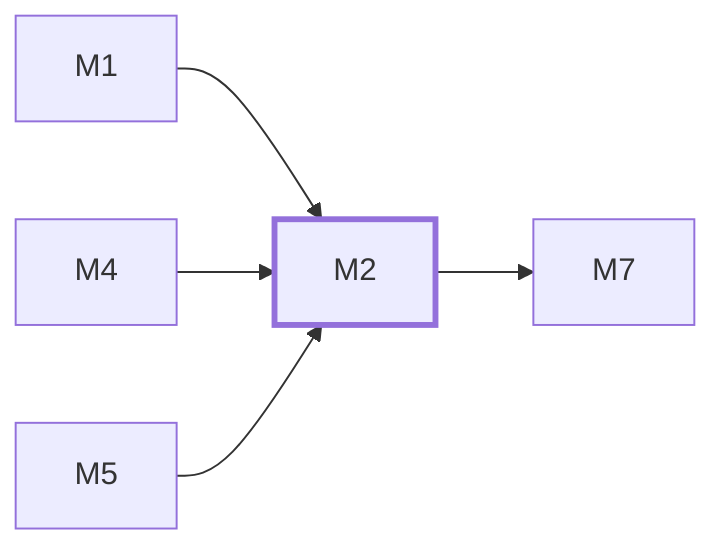

# M2　产品与 3D：负责产品列表、卡片和详情中的产品表达、直接模型操控、输入冲突处理、触屏与键盘查看、图片回退及带产品上下文的询盘入口。

## 依赖关系

- 本模块依赖：[[M1]]、[[M4]]、[[M5]]
- 被依赖：[[M7]]

## 下辖任务（8 个 · 11 人天）

| 任务 | 标题 | 预估 | 覆盖边界 |
|---|---|---|---|
| [[M2-T1]] | 扩展产品卡视口与精简信息区 | 1.5d | [[E-104]]、[[E-97]] |
| [[M2-T2]] | 修正模型直接拖动与滚轮焦点 | 2d | [[E-100]]、[[E-97]]、[[E-98]]、[[E-99]] |
| [[M2-T3]] | 接通模型键盘触屏与复位控件 | 1.5d | [[E-101]]、[[E-102]]、[[E-104]] |
| [[M2-T4]] | 定义模型分析事件生命周期纯规则 | 1d | — |
| [[M2-T5]] | 连接产品上下文到既有询盘表单 | 1d | — |
| [[M2-T6]] | 接通真实模型失败与海报回退 | 1d | — |
| [[M2-T7]] | 把真实GLB生命周期接入分析采集 | 1.5d | [[E-103]]、[[E-42]]、[[E-46]]、[[E-63]] |
| [[M2-T8]] | 贯通产品咨询与人工收件回复 | 1.5d | [[E-16]]、[[E-31]]、[[E-37]]、[[E-40]] |

## 涉及的边界

- [[E-16]]　在线聊天实现路线
- [[E-31]]　C-01 人工聊天收件与回复入口
- [[E-37]]　C-02 离线留言与发送失败恢复
- [[E-40]]　C-02 离线留言与发送失败恢复
- [[E-42]]　C-05 分析采集、去重与保留期
- [[E-46]]　C-05 分析采集、去重与保留期
- [[E-63]]　运维指标扩展及角色权限
- [[E-97]]　模型拖动所有权
- [[E-98]]　页面滚动与缩放
- [[E-99]]　自动旋转与用户意图
- [[E-100]]　失焦与取消
- [[E-101]]　键盘模型查看
- [[E-102]]　触屏手势
- [[E-103]]　真实模型失败与统计
- [[E-104]]　产品复位与显示

## 代码位置

<!-- code:begin -->
_（实施后回填。一行一处，格式：`路径:行号` — 说明）_
<!-- code:end -->

## 备注

<!-- notes:begin -->
_（本模块的设计取舍、踩过的坑。没有就留空。）_
<!-- notes:end -->
