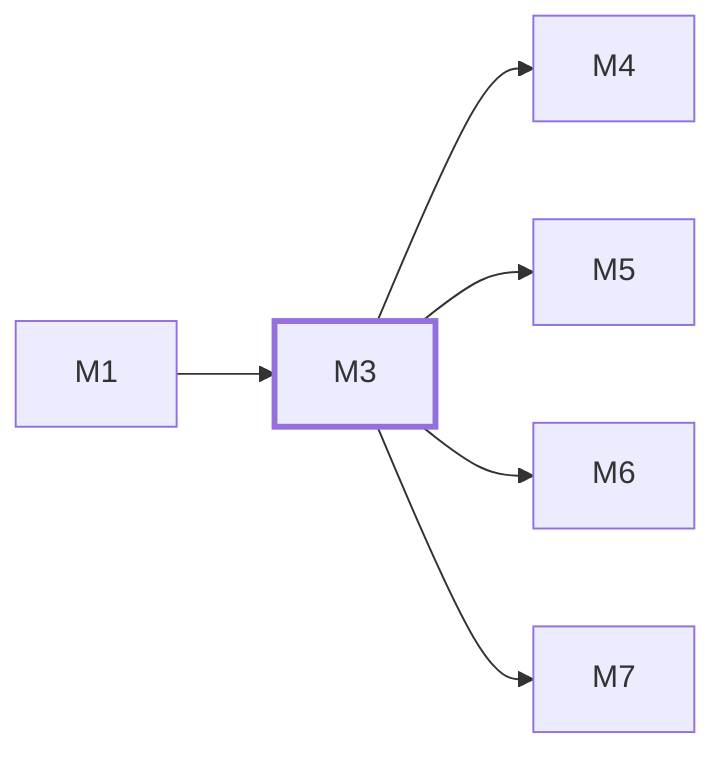

# M3　后台访问与账号：负责统一后台登录页和后台公共外壳、个人设置、设备会话、验证器绑定与登录方式切换、会话撤销及独立受限恢复，并负责既有后台页面的共享视觉迁移/回归；不改其询盘/邮件/规格/模型业务，消费 M1 的唯一视觉 token。

## 依赖关系

- 本模块依赖：[[M1]]
- 被依赖：[[M4]]、[[M5]]、[[M6]]、[[M7]]

## 下辖任务（25 个 · 29.5 人天）

| 任务 | 标题 | 预估 | 覆盖边界 |
|---|---|---|---|
| [[M3-T1]] | 将真实Auth.js会话绑定当前设备与权限 | 1.5d | [[E-01]]、[[E-02]]、[[E-03]]、[[E-69]]、[[E-70]] |
| [[M3-T10]] | 接通首次绑定表单与一次展示材料 | 0.5d | [[E-05]]、[[E-08]]、[[E-10]] |
| [[M3-T11]] | 接通独立恢复及受限重绑向导 | 1.5d | [[E-10]]、[[E-11]]、[[E-12]]、[[E-14]]、[[E-15]] |
| [[M3-T12]] | 接通个人安全页与共享新鲜验证对话框 | 2d | [[E-06]]、[[E-07]]、[[E-09]]、[[E-72]]、[[E-73]]、[[E-74]]、[[E-75]] |
| [[M3-T13]] | 接通退出全部设备确认与结果核实 | 0.5d | [[E-03]]、[[E-73]]、[[E-74]] |
| [[M3-T14]] | 接通新API配置、错误映射与脱敏计数 | 1d | — |
| [[M3-T15]] | 通过真实活动写回会话期限并验证四条Auth.js路径 | 1.5d | [[E-01]]、[[E-02]]、[[E-03]]、[[E-04]]、[[E-68]]、[[E-69]]、[[E-70]]、[[E-71]]、[[E-95]] |
| [[M3-T16]] | 原子切换本人登录方式与密码 | 1d | [[E-03]]、[[E-06]]、[[E-07]]、[[E-08]]、[[E-73]]、[[E-74]] |
| [[M3-T17]] | 提供本人设备列表及目标撤销API | 1d | [[E-03]]、[[E-70]]、[[E-73]]、[[E-74]] |
| [[M3-T18]] | 提供受OS权限保护的本地恢复预授权CLI | 1d | [[E-12]]、[[E-75]] |
| [[M3-T19]] | 原子核销恢复码或permit为受限会话 | 1.5d | [[E-10]]、[[E-11]]、[[E-14]] |
| [[M3-T2]] | 校验登录方式并原子核销当前验证器时间步 | 2d | [[E-05]]、[[E-06]]、[[E-08]]、[[E-72]]、[[E-96]] |
| [[M3-T20]] | 将本人换验证器接入受限重绑 | 0.5d | [[E-14]]、[[E-75]] |
| [[M3-T21]] | 迁移原询盘列表、详情与往来邮件视觉 | 2d | [[E-106]] |
| [[M3-T22]] | 迁移未归类邮件样式并保持关闭门禁 | 0.5d | [[E-107]] |
| [[M3-T23]] | 迁移既有模型上传和预览工作流视觉 | 1d | [[E-108]] |
| [[M3-T24]] | 迁移规格列表及品类编辑器视觉 | 1d | [[E-109]] |
| [[M3-T25]] | 统一既有站点设置和账号表完整视觉 | 2d | [[E-110]] |
| [[M3-T3]] | 签发一次性新鲜本人授权 | 1d | [[E-72]]、[[E-73]]、[[E-74]]、[[E-75]] |
| [[M3-T4]] | 签发管理员目标恢复permit | 1d | [[E-13]]、[[E-73]]、[[E-75]] |
| [[M3-T5]] | 接通受限重入绑定与最终一次确认 | 2d | [[E-08]]、[[E-14]]、[[E-15]] |
| [[M3-T6]] | 接通唯一登录页和明确方式字段 | 1d | [[E-09]]、[[E-95]]、[[E-96]] |
| [[M3-T7]] | 统一后台外壳并只上报真实活动 | 1d | [[E-03]]、[[E-68]]、[[E-70]] |
| [[M3-T8]] | 显示本人设备并退出指定设备 | 1d | [[E-70]]、[[E-73]] |
| [[M3-T9]] | 在账号行复用验证对话框授权恢复 | 0.5d | [[E-13]]、[[E-73]] |

## 涉及的边界

- [[E-01]]　会话持久化与记住设备期限
- [[E-02]]　会话持久化与记住设备期限
- [[E-03]]　会话持久化与记住设备期限
- [[E-04]]　会话持久化与记住设备期限
- [[E-05]]　C-03 验证器绑定与无密码默认开关
- [[E-06]]　C-03 验证器绑定与无密码默认开关
- [[E-07]]　C-03 验证器绑定与无密码默认开关
- [[E-08]]　C-03 验证器绑定与无密码默认开关
- [[E-09]]　C-03 验证器绑定与无密码默认开关
- [[E-10]]　C-04 验证器丢失与单管理员恢复
- [[E-11]]　C-04 验证器丢失与单管理员恢复
- [[E-12]]　C-04 验证器丢失与单管理员恢复
- [[E-13]]　C-04 验证器丢失与单管理员恢复
- [[E-14]]　C-04 验证器丢失与单管理员恢复
- [[E-15]]　C-04 验证器丢失与单管理员恢复
- [[E-68]]　设备会话与Auth.js期限接合
- [[E-69]]　设备会话与Auth.js期限接合
- [[E-70]]　设备会话与Auth.js期限接合
- [[E-71]]　设备会话与Auth.js期限接合
- [[E-72]]　敏感设置的新鲜本人验证
- [[E-73]]　敏感设置的新鲜本人验证
- [[E-74]]　敏感设置的新鲜本人验证
- [[E-75]]　敏感设置的新鲜本人验证
- [[E-95]]　登录记住设备字段
- [[E-96]]　登录方式枚举与账号隐私
- [[E-106]]　既有询盘与邮件往来视觉统一
- [[E-107]]　条件关闭后台邮件的视觉迁移
- [[E-108]]　既有模型管理视觉升级
- [[E-109]]　既有规格列表和编辑器视觉统一
- [[E-110]]　旧设置与账号管理完整视觉升级

## 代码位置

<!-- code:begin -->
_（实施后回填。一行一处，格式：`路径:行号` — 说明）_
<!-- code:end -->

## 备注

<!-- notes:begin -->
_（本模块的设计取舍、踩过的坑。没有就留空。）_
<!-- notes:end -->
