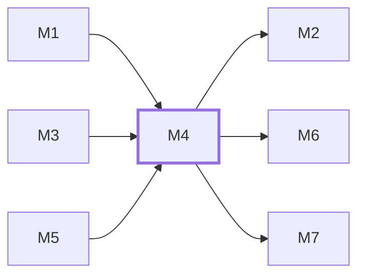

# M4　第一方人工咨询：负责访客必要会话、人工消息与离线留言、ADMIN/SALES 收件箱和回复、未读、失败草稿与幂等重试，并保存真实收件和通知结果。

## 依赖关系

- 本模块依赖：[[M1]]、[[M3]]、[[M5]]
- 被依赖：[[M2]]、[[M6]]、[[M7]]

## 下辖任务（15 个 · 16 人天）

| 任务 | 标题 | 预估 | 覆盖边界 |
|---|---|---|---|
| [[M4-T1]] | 原子保存咨询首消息及唯一通知出箱 | 1.5d | [[E-18]]、[[E-31]]、[[E-39]]、[[E-40]]、[[E-90]] |
| [[M4-T10]] | 幂等追加访客消息并更新咨询保留期限 | 0.5d | [[E-18]]、[[E-33]]、[[E-37]]、[[E-78]]、[[E-86]]、[[E-90]] |
| [[M4-T11]] | 保存真实人工回复并关闭咨询 | 1d | [[E-16]]、[[E-31]]、[[E-32]]、[[E-33]]、[[E-78]] |
| [[M4-T12]] | 注册既有邮件队列真实POST调度 | 0.5d | [[E-35]]、[[E-41]]、[[E-94]] |
| [[M4-T13]] | 在隔离授权策略下原子匿名化过期咨询 | 1d | [[E-86]]、[[E-87]]、[[E-88]]、[[E-89]] |
| [[M4-T14]] | 在真实双端会话接通人工回复与关闭 | 1d | [[E-16]]、[[E-31]]、[[E-33]]、[[E-35]]、[[E-41]]、[[E-78]] |
| [[M4-T15]] | 移除Tawk接线并说明必要人工咨询 | 0.5d | [[E-20]]、[[E-40]] |
| [[M4-T2]] | 读取访客消息页并单调推进读位置 | 1d | [[E-19]]、[[E-34]]、[[E-77]]、[[E-79]]、[[E-85]] |
| [[M4-T3]] | 查询当前授权运营的收件箱及读状态 | 1d | [[E-19]]、[[E-32]]、[[E-34]]、[[E-35]]、[[E-41]]、[[E-78]]、[[E-79]]、[[E-86]]、[[E-89]] |
| [[M4-T4]] | 消费持久聊天通知并注册每分钟作业 | 2d | [[E-35]]、[[E-41]]、[[E-90]]、[[E-91]]、[[E-92]]、[[E-93]]、[[E-94]] |
| [[M4-T5]] | 接通访客聊天打开与消息编辑器 | 1.5d | [[E-17]]、[[E-31]]、[[E-36]]、[[E-38]]、[[E-39]]、[[E-40]]、[[E-47]]、[[E-85]] |
| [[M4-T6]] | 接通运营收件箱和只读会话页 | 1d | [[E-31]]、[[E-32]]、[[E-34]]、[[E-35]]、[[E-41]]、[[E-76]]、[[E-77]]、[[E-78]]、[[E-79]] |
| [[M4-T7]] | 注册聊天保留候选与默认拒绝真实清理 | 1d | [[E-85]]、[[E-86]]、[[E-88]] |
| [[M4-T8]] | 建立主动联系才签发的必要cookie | 1d | [[E-40]]、[[E-85]] |
| [[M4-T9]] | 集成聊天轮询、断网重试与失权停止 | 1.5d | [[E-18]]、[[E-37]]、[[E-38]]、[[E-76]]、[[E-77]]、[[E-78]]、[[E-85]] |

## 涉及的边界

- [[E-16]]　在线聊天实现路线
- [[E-17]]　在线聊天实现路线
- [[E-18]]　在线聊天实现路线
- [[E-19]]　在线聊天实现路线
- [[E-20]]　在线聊天实现路线
- [[E-31]]　C-01 人工聊天收件与回复入口
- [[E-32]]　C-01 人工聊天收件与回复入口
- [[E-33]]　C-01 人工聊天收件与回复入口
- [[E-34]]　C-01 人工聊天收件与回复入口
- [[E-35]]　C-01 人工聊天收件与回复入口
- [[E-36]]　C-02 离线留言与发送失败恢复
- [[E-37]]　C-02 离线留言与发送失败恢复
- [[E-38]]　C-02 离线留言与发送失败恢复
- [[E-39]]　C-02 离线留言与发送失败恢复
- [[E-40]]　C-02 离线留言与发送失败恢复
- [[E-41]]　C-02 离线留言与发送失败恢复
- [[E-47]]　C-05 分析采集、去重与保留期
- [[E-76]]　人工聊天同步机制
- [[E-77]]　人工聊天同步机制
- [[E-78]]　人工聊天同步机制
- [[E-79]]　人工聊天同步机制
- [[E-85]]　聊天凭据及数据保留期限
- [[E-86]]　聊天凭据及数据保留期限
- [[E-87]]　聊天凭据及数据保留期限
- [[E-88]]　聊天凭据及数据保留期限
- [[E-89]]　聊天凭据及数据保留期限
- [[E-90]]　聊天通知持久队列
- [[E-91]]　聊天通知持久队列
- [[E-92]]　聊天通知持久队列
- [[E-93]]　聊天通知持久队列
- [[E-94]]　聊天通知持久队列

## 代码位置

<!-- code:begin -->
_（实施后回填。一行一处，格式：`路径:行号` — 说明）_
<!-- code:end -->

## 备注

<!-- notes:begin -->
_（本模块的设计取舍、踩过的坑。没有就留空。）_
<!-- notes:end -->
