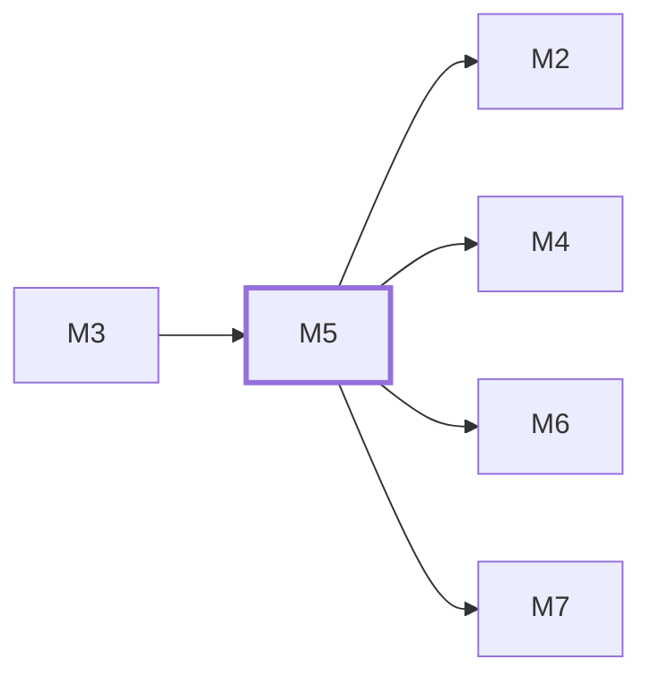

# M5　同意与统计账本：负责分析同意、匿名浏览器与事件标识、采集准入和去重、站点统计时区设置、日与产品聚合、原始与聚合保留及可重算边界，产出真实访问和 3D 统计。

## 依赖关系

- 本模块依赖：[[M3]]
- 被依赖：[[M2]]、[[M4]]、[[M6]]、[[M7]]

## 下辖任务（11 个 · 14 人天）

| 任务 | 标题 | 预估 | 覆盖边界 |
|---|---|---|---|
| [[M5-T1]] | 建立JobState租约与代次仓储原语 | 1d | — |
| [[M5-T10]] | 呈现ADMIN时区表单与保存反馈 | 1d | [[E-59]] |
| [[M5-T11]] | 注册默认dry-run的分析保留任务 | 1d | [[E-48]]、[[E-82]] |
| [[M5-T2]] | 接通服务端分析同意签名cookie | 1d | — |
| [[M5-T3]] | 以一致快照重算并原子替换日聚合 | 2d | [[E-56]]、[[E-57]]、[[E-58]]、[[E-80]]、[[E-81]]、[[E-82]]、[[E-83]] |
| [[M5-T4]] | 接通时区设置HTTP与重算范围查询 | 1d | [[E-58]]、[[E-59]] |
| [[M5-T5]] | 实现分析保留候选与覆盖边界计划器 | 0.5d | — |
| [[M5-T6]] | 持久化严格白名单分析事件 | 1.5d | [[E-47]] |
| [[M5-T7]] | 接通同意UI、页面事件与隐私说明 | 2d | [[E-42]]、[[E-43]]、[[E-45]] |
| [[M5-T8]] | 注册聚合作业并接通真实5分钟cron | 2d | [[E-44]]、[[E-60]]、[[E-81]]、[[E-84]] |
| [[M5-T9]] | 建立版本化IANA时区与自然日仓储规则 | 1d | — |

## 涉及的边界

- [[E-42]]　C-05 分析采集、去重与保留期
- [[E-43]]　C-05 分析采集、去重与保留期
- [[E-44]]　C-05 分析采集、去重与保留期
- [[E-45]]　C-05 分析采集、去重与保留期
- [[E-46]]　C-05 分析采集、去重与保留期
- [[E-47]]　C-05 分析采集、去重与保留期
- [[E-48]]　C-05 分析采集、去重与保留期
- [[E-55]]　今日统计的站点时区与历史重算
- [[E-56]]　今日统计的站点时区与历史重算
- [[E-57]]　今日统计的站点时区与历史重算
- [[E-58]]　今日统计的站点时区与历史重算
- [[E-59]]　今日统计的站点时区与历史重算
- [[E-60]]　今日统计的站点时区与历史重算
- [[E-80]]　分析聚合与水位发布
- [[E-81]]　分析聚合与水位发布
- [[E-82]]　分析聚合与水位发布
- [[E-83]]　分析聚合与水位发布
- [[E-84]]　分析聚合与水位发布

## 代码位置

<!-- code:begin -->
_（实施后回填。一行一处，格式：`路径:行号` — 说明）_
<!-- code:end -->

## 备注

<!-- notes:begin -->
_（本模块的设计取舍、踩过的坑。没有就留空。）_
<!-- notes:end -->
