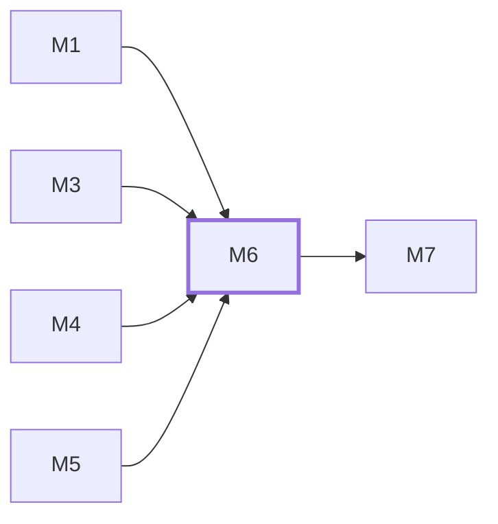

# M6　业务与运维看板：负责按角色查询并解释统计结果，读取询盘、聊天、接口错误、邮件、存储和备份的真实来源，区分数据时间、零值、无数据、未接入、失败和旧值。

## 依赖关系

- 本模块依赖：[[M1]]、[[M3]]、[[M4]]、[[M5]]
- 被依赖：[[M7]]

## 下辖任务（7 个 · 10 人天）

| 任务 | 标题 | 预估 | 覆盖边界 |
|---|---|---|---|
| [[M6-T1]] | 定义统计查询范围与核心来源DTO | 1d | [[E-49]]、[[E-50]]、[[E-55]]、[[E-63]] |
| [[M6-T2]] | 接入询盘与聊天只读业务计数 | 1d | [[E-62]]、[[E-66]] |
| [[M6-T3]] | 登记存储备份报告与运维采样 | 2d | [[E-65]]、[[E-66]]、[[E-67]] |
| [[M6-T4]] | 交付可导航的核心数据看板页面 | 1.5d | [[E-61]]、[[E-63]]、[[E-66]] |
| [[M6-T5]] | 接入HTTP和邮件可靠性来源 | 1.5d | [[E-51]]、[[E-52]]、[[E-53]]、[[E-64]]、[[E-67]] |
| [[M6-T6]] | 接通受角色限制的真实统计HTTP入口 | 1.5d | [[E-55]]、[[E-58]]、[[E-61]]、[[E-66]] |
| [[M6-T7]] | 完成看板逐源状态与故障呈现 | 1.5d | [[E-49]]、[[E-50]]、[[E-51]]、[[E-52]]、[[E-53]]、[[E-54]]、[[E-67]] |

## 涉及的边界

- [[E-49]]　C-06 看板数据时间与异常状态
- [[E-50]]　C-06 看板数据时间与异常状态
- [[E-51]]　C-06 看板数据时间与异常状态
- [[E-52]]　C-06 看板数据时间与异常状态
- [[E-53]]　C-06 看板数据时间与异常状态
- [[E-54]]　C-06 看板数据时间与异常状态
- [[E-55]]　今日统计的站点时区与历史重算
- [[E-58]]　今日统计的站点时区与历史重算
- [[E-61]]　运维指标扩展及角色权限
- [[E-62]]　运维指标扩展及角色权限
- [[E-63]]　运维指标扩展及角色权限
- [[E-64]]　运维指标扩展及角色权限
- [[E-65]]　运维指标扩展及角色权限
- [[E-66]]　运维指标扩展及角色权限
- [[E-67]]　运维指标扩展及角色权限

## 代码位置

<!-- code:begin -->
_（实施后回填。一行一处，格式：`路径:行号` — 说明）_
<!-- code:end -->

## 备注

<!-- notes:begin -->
_（本模块的设计取舍、踩过的坑。没有就留空。）_
<!-- notes:end -->
