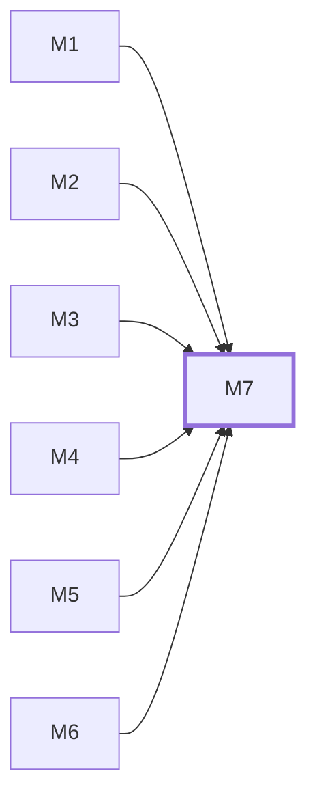

# M7　集成验收与交付：负责访客跨模块完整路径、后台权限与恢复路径、统计和可靠性完整链路的真实集成验收及交付证据收口；核对本轮复用的恢复来源，不重做 S1 已完成的取回和来源审计，也不自动合并恢复草稿。

## 依赖关系

- 本模块依赖：[[M1]]、[[M2]]、[[M3]]、[[M4]]、[[M5]]、[[M6]]
- 被依赖：无，没有模块等它

## 下辖任务（9 个 · 13.5 人天）

| 任务 | 标题 | 预估 | 覆盖边界 |
|---|---|---|---|
| [[M7-T1]] | 终验公开媒体与3D访客路径 | 1.5d | [[E-104]]、[[E-111]]、[[E-21]]、[[E-24]]、[[E-26]]、[[E-29]]、[[E-30]] |
| [[M7-T2]] | 终验真实会话跨路径持久与撤销 | 1.5d | [[E-01]]、[[E-02]]、[[E-03]]、[[E-04]]、[[E-69]]、[[E-70]]、[[E-71]]、[[E-96]] |
| [[M7-T3]] | 终验同意到分析看板及统计日界线 | 2d | [[E-42]]、[[E-48]]、[[E-56]]、[[E-61]]、[[E-63]]、[[E-81]]、[[E-88]] |
| [[M7-T4]] | 终验询盘聊天闭环与容量降级 | 1.5d | [[E-16]]、[[E-18]]、[[E-20]]、[[E-31]]、[[E-37]]、[[E-40]] |
| [[M7-T5]] | 终验受限恢复与单管理员兜底 | 2d | [[E-10]]、[[E-11]]、[[E-14]]、[[E-15]] |
| [[M7-T6]] | 终验新鲜本人授权与忘密码隔离 | 1.5d | [[E-08]]、[[E-72]]、[[E-73]]、[[E-74]]、[[E-75]] |
| [[M7-T7]] | 终验运维来源与通知重启消费 | 1.5d | [[E-64]]、[[E-65]]、[[E-67]]、[[E-94]] |
| [[M7-T8]] | 核对恢复候选的当前来源与安全批准 | 0.5d | [[E-105]] |
| [[M7-T9]] | 验收既有分发脚本与隔离备份恢复链 | 1.5d | [[E-65]] |

## 涉及的边界

- [[E-01]]　会话持久化与记住设备期限
- [[E-02]]　会话持久化与记住设备期限
- [[E-03]]　会话持久化与记住设备期限
- [[E-04]]　会话持久化与记住设备期限
- [[E-08]]　C-03 验证器绑定与无密码默认开关
- [[E-10]]　C-04 验证器丢失与单管理员恢复
- [[E-11]]　C-04 验证器丢失与单管理员恢复
- [[E-14]]　C-04 验证器丢失与单管理员恢复
- [[E-15]]　C-04 验证器丢失与单管理员恢复
- [[E-16]]　在线聊天实现路线
- [[E-18]]　在线聊天实现路线
- [[E-20]]　在线聊天实现路线
- [[E-21]]　主页视频、JPG、GIF加载与控制
- [[E-24]]　主页视频、JPG、GIF加载与控制
- [[E-26]]　自己的Logo与参考PDF事实边界
- [[E-29]]　自己的Logo与参考PDF事实边界
- [[E-30]]　自己的Logo与参考PDF事实边界
- [[E-31]]　C-01 人工聊天收件与回复入口
- [[E-37]]　C-02 离线留言与发送失败恢复
- [[E-40]]　C-02 离线留言与发送失败恢复
- [[E-42]]　C-05 分析采集、去重与保留期
- [[E-48]]　C-05 分析采集、去重与保留期
- [[E-56]]　今日统计的站点时区与历史重算
- [[E-61]]　运维指标扩展及角色权限
- [[E-63]]　运维指标扩展及角色权限
- [[E-64]]　运维指标扩展及角色权限
- [[E-65]]　运维指标扩展及角色权限
- [[E-67]]　运维指标扩展及角色权限
- [[E-69]]　设备会话与Auth.js期限接合
- [[E-70]]　设备会话与Auth.js期限接合
- [[E-71]]　设备会话与Auth.js期限接合
- [[E-72]]　敏感设置的新鲜本人验证
- [[E-73]]　敏感设置的新鲜本人验证
- [[E-74]]　敏感设置的新鲜本人验证
- [[E-75]]　敏感设置的新鲜本人验证
- [[E-81]]　分析聚合与水位发布
- [[E-88]]　聊天凭据及数据保留期限
- [[E-94]]　聊天通知持久队列
- [[E-96]]　登录方式枚举与账号隐私
- [[E-104]]　产品复位与显示
- [[E-105]]　恢复候选代码的来源与发布边界
- [[E-111]]　公司图稿、可编辑源工程及品牌来源可追溯

## 代码位置

<!-- code:begin -->
_（实施后回填。一行一处，格式：`路径:行号` — 说明）_
<!-- code:end -->

## 备注

<!-- notes:begin -->
_（本模块的设计取舍、踩过的坑。没有就留空。）_
<!-- notes:end -->
